# SLM vs Qwen Fine-Tune: Two Training Paths on Empathetic Data


-orange)


## Executive Summary

This repository compares **two language model approaches** trained on overlapping empathetic dialogue data:

1. **From-scratch SLM** — A medium-sized (~253M → ~757M parameter) GPT-style transformer trained from random initialization on a code+prose corpus, then further trained on empathetic dialogue data.
2. **Qwen2.5-0.5B fine-tune** — Qwen2.5-0.5B-Instruct (0.5B params) specialized with two QLoRA stages (empathy SFT, then a steering pass) and merged to fp16 at `slm-ft/merged_fp16/`. It sits between the 253M and 757M SLM tiers, so it serves as a mid-range reference rather than a size-parity match.

> **Important note on the Qwen artifact:** The merged fp16 artifact at `slm-ft/merged_fp16/` is now the real fine-tuned weight file (988,097,536 bytes). The live prompt comparison (`slm-comparison/comparison_samples_latest.json`) predates that merge and still uses base `Qwen/Qwen2.5-0.5B-Instruct` as its Qwen tier; the benchmark matrices load the merged artifact directly.

The repo is **not** a claim that one model is a distilled or compressed version of the other. It is a portfolio-side-by-side comparison of two real training pipelines on the same task, with reproducible artifacts, data documentation, comparison scripts, and a unified harness for verification.

> **License note:** The training data includes EmpatheticDialogues (CC BY-NC-4.0) and ESConv (CC BY-NC-SA). See the License section below.

---

## Table of Contents

1. [Project Structure](#1-project-structure)
2. [From-Scratch SLM](#2-from-scratch-slm) — Architecture, training, and inference
3. [Qwen2.5-0.5B Comparison Baseline](#3-qwen25-05b-comparison-baseline) — Benchmark baseline
4. [Comparison Methodology](#4-comparison-methodology) — How the comparison was generated
5. [Data Pipeline](#5-data-pipeline) — Where the training data comes from
6. [Architecture Diagrams](#6-architecture-diagrams) — Mermaid diagrams
7. [Training Details](#7-training-details) — Hyperparameters, losses, and training loops
8. [Inference & Generation](#8-inference--generation) — How to run generation
9. [Benchmarks](#9-benchmarks) — Performance and quality metrics
10. [Auto-Training Loop](#10-auto-training-loop) — Automated training harness
11. [What We Tried / Kept / Cut](#11-what-we-tried--kept--cut)
12. [Docker Deployment](#12-docker-deployment) — Containerized, reproducible environment
13. [API Server](#13-api-server) — FastAPI inference endpoint
14. [Testing & Quality](#14-testing--quality) — Test suite, coverage, linting, type checking
15. [Reproducibility](#15-reproducibility) — Seeded generation, constraints, pre-commit
16. [Notebooks & Analysis](#16-notebooks--analysis) — Jupyter notebooks for EDA
17. [License](#17-license) — Legal and ethical considerations
18. [Known Issues](#18-known-issues) — Current limitations and workarounds
19. [Reproducing the Comparison](#19-reproducing-the-comparison) — Step-by-step guide
20. [Retrieval-Augmented Generation (RAG)](#20-retrieval-augmented-generation-rag) — Lightweight TF-IDF RAG demo
21. [Additional Resources](#21-additional-resources)

---

## 1. Project Structure

```text
.
├── MODEL_COMPARISON.md          — Detailed data, size, split, and benchmark tables
├── MODEL_CARD.md                — Model card for HuggingFace Hub
├── SLM_ARCHITECTURE.md          — Architecture diagrams and model details
├── README.md                    — This file
├── pyproject.toml               — Project metadata, tool config, dependencies
├── requirements.txt             — Runtime dependencies
├── constraints.txt              — Pinned dependency versions
├── Makefile                     — Build/test/bench/verify shortcuts
├── .env.example                 — Environment variable template
├── .gitignore                   — Git ignore rules
├── .pre-commit-config.yaml      — Pre-commit hooks
├── run_all.py                   — Single entry-point for full pipeline
├── verify_setup.py              — Setup artifact verification
├── evaluate_test_split.py       — Held-out test split evaluation
├── slm_api.py                   — FastAPI inference server
├── notebooks/
│   └── token_analysis.ipynb     — Token distribution EDA
├── slm-training/                — From-scratch SLM pipeline
│   ├── model.py                 — GPT architecture (~757M params, 24L/24H/1536D)
│   ├── train.py                 — Training loop
│   ├── inference.py             — Text generation
│   ├── preprocess.py            — Code-corpus tokenization + split
│   ├── preprocess_clean.py      — Role-marked dialogue+QA corpus builder
│   ├── distill_qwen.py          — Distil Qwen2.5-0.5B answers into the corpus
│   ├── empathy_train.bin        — Legacy empathy tokens, no role markers (~2.1M)
│   ├── empathy_val.bin          — Legacy empathy validation tokens (~44.3K)
│   ├── clean_train.bin          — Clean role-marked corpus (~5.9M, incl. 1M code)
│   ├── clean_val.bin            — Clean validation split (~157K)
│   ├── clean_stats.json         — Clean corpus statistics
│   ├── qwen_distill.jsonl       — Qwen-distilled answers (20K Alpaca records)
│   ├── best_model.pt            — 16L/1024D, step 500, val 4.2803
│   ├── best_empathy_model.pt    — 16L/1024D, step 500, val 4.2803
│   ├── best_empathy_model_v2.pt — 24L/24H/1536D, step 1000, val 3.9259
│   ├── best_clean_model.pt      — 16L/1024D, step 2500, val 4.0473
│   ├── best_clean_model_v2.pt   — CLI/API default; 16L/1024D, step 8000, val 3.2289
│   ├── best_clean_model_v3.pt   — 16L/1024D, step 3900, val 2.9197
│   ├── checkpoints_757m/        — 24L checkpoints (steps 600/800/1000)
│   ├── final_model.pt           — 16L/1024D, step 4000, val 2.9215
│   ├── training_config.json     — Current training configuration
│   ├── training_stats.json      — Training statistics
│   ├── losses.json              — Loss history
│   ├── preprocess_stats.json    — Corpus statistics
│   ├── scrape_stats.json        — Scrape statistics
│   └── TRAINING_REPORT.md       — Training results and analysis
├── slm-ft/                      — Qwen2.5-0.5B comparison baseline and fine-tune
│   ├── train_qlora.py           — QLoRA training script
│   ├── merge_adapter.py         — LoRA adapter → merged fp16 weights
│   ├── prepare_data.py          — Data preparation
│   ├── steering/                — Stage-2 policy steering
│   ├── adapter/                 — Stage-1 LoRA adapter (real weights)
│   ├── adapter_stage2/          — Stage-2 steering adapter (real weights)
│   ├── merged_fp16/             — Merged fp16 deployment artifact (988 MB real weights)
│   ├── behavioral_eval.json     — Earlier 5/5 probe record (2026-10-20, stale)
│   └── data/                    — SFT corpora (gitignored; regenerate with prepare_data.py)
├── slm-comparison/              — Same-prompt comparison outputs
│   ├── generate_live_comparison.py — Live benchmark runner (real checkpoints)
│   ├── comparison_samples_latest.json — Tracked structured comparison results
│   ├── comparison_samples_latest.md — Human-readable report
│   ├── comparison_samples.json  — Generated output (gitignored)
│   └── comparison_test.json/.md — Older test run
├── benchmarks/                  — Reproducible model-family benchmarks
│   ├── bench_slm_model_families.py — Benchmark generation
│   ├── bench_forward_matrix.py — Forward-pass throughput matrix
│   ├── bench_generation_matrix.py — Generation throughput matrix
│   ├── evaluate_empathy.py     — Empathy evaluation harness
│   ├── benchmark_report.json/.md — Benchmark report
│   ├── slm_live_results.json    — Live SLM benchmark results
│   ├── qwen_base_results.json   — Live Qwen benchmark results
│   ├── forward_matrix.json      — Forward-pass matrix results
│   ├── generation_matrix.json   — Generation throughput results
│   ├── empathy_eval.json/.md    — Empathy evaluation results
│   └── test_split_eval.json     — Held-out test split evaluation
└── docs/
    ├── Training_Data_Markdown.md — Data sources and pipeline documentation
    └── production_grade_comparison.md — 757M SLM vs production-grade models (speed/quality tradeoff, N/R where unmeasured)
```

### Project Structure Diagram

```mermaid
graph TB
    subgraph Root[Repository Root]
        direction TB
        A[README.md]
        B[MODEL_COMPARISON.md]
        C[SLM_ARCHITECTURE.md]
        D[MODEL_CARD.md]
        E[pyproject.toml]
        F[requirements.txt]
        G[constraints.txt]
        H[Makefile]
        I[.env.example]
        J[.gitignore]
        K[.pre-commit-config.yaml]
    end

    subgraph scripts[scripts/]
        direction TB
        S1[run_all.py]
        S2[verify_setup.py]
        S3[evaluate_test_split.py]
        S4[slm_api.py]
        S5[harness.py]
        S6[download_qwen_base.py]
        S7[download_empathetic_dialogues.py]
        S8[experiment_tracker.py]
        S9[generate_provenance.py]
    end

    subgraph slm_training[slm-training/]
        direction TB
        T1[model.py]
        T2[train.py]
        T3[inference.py]
        T4[preprocess.py]
        T5[best_model.pt]
        T6[train.bin / val.bin]
        T7[TRAINING_REPORT.md]
    end

    subgraph slm_ft[slm-ft/]
        direction TB
        F1[train_qlora.py]
        F2[prepare_data.py]
        F3[steering/]
        F4[adapter/]
        F5[adapter_stage2/]
        F6[merged_fp16/]
        F7[behavioral_eval.json]
    end

    subgraph slm-comparison[slm-comparison/]
        direction TB
        C1[generate_live_comparison.py]
        C2[comparison_samples.json]
        C3[comparison_samples.md]
    end

    subgraph benchmarks[benchmarks/]
        direction TB
        B1[benchmark_report.md]
        B2[slm_live_results.json]
        B3[qwen_base_results.json]
        B4[slm_forward_bench.json]
        B5[qwen_forward_bench.json]
        B6[test_split_eval.json]
    end

    subgraph notebooks[notebooks/]
        NB1[token_analysis.ipynb]
    end

    subgraph tests[tests/]
        TS1[test_benchmarks.py]
    end

    Root --> scripts
    Root --> slm_training
    Root --> slm_ft
    Root --> slm-comparison
    Root --> benchmarks
    Root --> notebooks
    Root --> tests
```

---

## 2. From-Scratch SLM

### 2.1 What This Model Is

The from-scratch SLM is a **decoder-only transformer** trained from random initialization on a corpus of code prose: comments, docstrings, README text, and technical documentation scraped from public GitHub repositories. It is **not** a chat assistant, **not** instruction-tuned, and **not** distilled from a larger model. It is a teaching and portfolio artifact that demonstrates the full training loop end to end.

### 2.2 Model Specification

| Component | Value (Current) | Value (Legacy 253M) | Explanation |
|-----------|-------|-------------------|-------------|
| **Parameter count** | ~757M | ~253M | Scaled for better capacity |
| **Non-embedding params** | ~680M | ~202M | Model body excluding token embedding + LM head |
| **Tokenizer** | GPT-2 BPE (tiktoken) | GPT-2 BPE (tiktoken) | 50,257 vocabulary tokens |
| **Context length** | 256 tokens | 256 tokens | Training and inference window |
| **Architecture** | GPT-style, decoder-only | GPT-style, decoder-only | Causal self-attention, no encoder |
| **Layers** | 24 transformer blocks | 16 transformer blocks | `n_layer = 24` |
| **Attention heads** | 24 heads | 16 heads | `n_head = 24`, head_dim = 64 |
| **Embedding dim** | 1536 | 1024 | `n_embd = 1536` |
| **MLP ratio** | 4× expansion | 4× expansion | Hidden size = 6,144 |
| **Activation** | GELU (approximate tanh) | GELU (approximate tanh) | Used in MLP |
| **Normalization** | LayerNorm (pre-norm) | LayerNorm (pre-norm) | With bias, per GPT-2 |
| **Weight tying** | Token embedding → LM head | Token embedding → LM head | Saves ~77M parameters |
| **Dropout** | 0.1 | 0.1 | Applied to embeddings, attention, residuals |
| **Position encoding** | Learned positional embeddings | Learned positional embeddings | `wpe` of shape (256, 1536) |
| **Gradient checkpointing** | Enabled | Enabled | Reduces memory footprint by ~40% |

### 2.3 Architecture Deep Dive

The model follows the GPT-2 architecture with deliberate simplifications for CPU training. Here is how every component works:

#### 2.3.1 Token and Position Embeddings

```python
self.transformer.wte = nn.Embedding(vocab_size, n_embd)  # (50257, 1536)
self.transformer.wpe = nn.Embedding(block_size, n_embd)  # (256, 1536)
self.transformer.drop = nn.Dropout(dropout)
```

When a prompt arrives as token IDs, each ID is looked up in `wte` to get a 1536-dimensional vector. Position IDs `0, 1, 2, ...` are looked up in `wpe`. The two are added together and passed through dropout. This gives the model information about *what* token is present and *where* it is in the sequence.

**Why learned positions?** Sinusoidal positional encodings (Vaswani et al.) are fixed functions of position. Learned positions let the optimizer adjust position vectors to fit the training data. At 256 positions × 1536 dims, this is only 393,216 parameters — negligible compared to the rest of the model.

#### 2.3.2 Transformer Block

Each of the 24 blocks applies the same sequence of operations:

```
x = x + attention( LayerNorm(x) )
x = x + mlp( LayerNorm(x) )
```

This is the **pre-norm** pattern. Normalizing *before* each sub-layer (attention and MLP) stabilizes training, especially for deeper networks. The residual connections (`x + ...`) let gradients flow directly through the network without being attenuated by 10 normalization+non-linearity pairs.

##### 2.3.2.1 Causal Self-Attention

```python
class CausalSelfAttention:
    def __init__(self, cfg):
        self.c_attn = nn.Linear(n_embd, 3 * n_embd)  # Q, K, V in one projection
        self.c_proj = nn.Linear(n_embd, n_embd)  # Output projection
```

The combined `c_attn` projection takes the 1536-dimensional input and projects it to 4,608 dimensions, which are then split into Q (1536), K (1536), and V (1536). This is more memory-efficient than three separate linear layers because it performs one matrix multiply instead of three.

**Causal masking:** The attention mechanism must not look at future tokens. During training and inference, a lower-triangular mask prevents each position from attending to positions after it. In this implementation, PyTorch's `scaled_dot_product_attention` with `is_causal=True` handles this efficiently on CPU.

**Why 24 heads?** With 1536 dimensions and 24 heads, each head operates on 64-dimensional subspaces. Multi-head attention lets the model attend to different types of relationships simultaneously: one head might track subject-verb agreement, another might track variable types in code, another might track opening/closing brackets.

##### 2.3.2.2 MLP (Feed-Forward Network)

```python
class MLP:
    def __init__(self, cfg):
        self.c_fc = nn.Linear(n_embd, 4 * n_embd)  # (1536, 6144)
        self.c_proj = nn.Linear(4 * n_embd, n_embd)  # (6144, 1536)
```

The MLP is a two-layer network with a 4× expansion. The first layer projects from 1536 to 6,144 dimensions, applies GELU activation, and the second layer projects back to 1536. This is the **"token mixer"** of the transformer: while attention mixes information *between* tokens, the MLP transforms each token's representation *independently*.

**Why GELU?** GELU (Gaussian Error Linear Unit) smooths the ReLU by multiplying by the cumulative distribution function of a Gaussian. It is the activation used in the original GPT-2 and BERT models, and it consistently outperforms ReLU in transformer architectures.

##### 2.3.2.3 Weight Initialization

```python
self.apply(self._init_weights)
for name, p in self.named_parameters():
    if name.endswith("c_proj.weight"):
        nn.init.normal_(p, mean=0.0, std=0.02 / math.sqrt(2 * n_layer))
```

Most weights are initialized from a normal distribution with std=0.02. The residual projections (`c_proj` in attention and MLP) use a smaller standard deviation (`0.02 / sqrt(2 * n_layer)`) because they are added to the residual stream. This **scaled initialization** (from GPT-2 section 2.3) prevents the residual stream from growing or shrinking uncontrollably as it passes through 24 layers.

##### 2.3.2.4 Weight Tying

```python
self.transformer.wte.weight = self.lm_head.weight
```

The token embedding matrix (50,257 × 1536 = 77.2M parameters) is shared with the language modeling head. At inference time, the model computes logits by multiplying the final hidden state by this shared matrix. Weight tying is both a memory optimization and a regularizer: it forces the embedding space to be directly useful for prediction.

### 2.4 Architecture Diagram

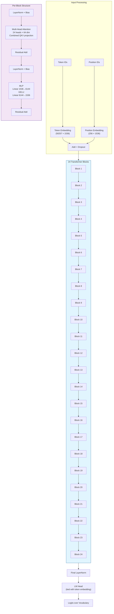

### 2.5 Data Flow Sequence

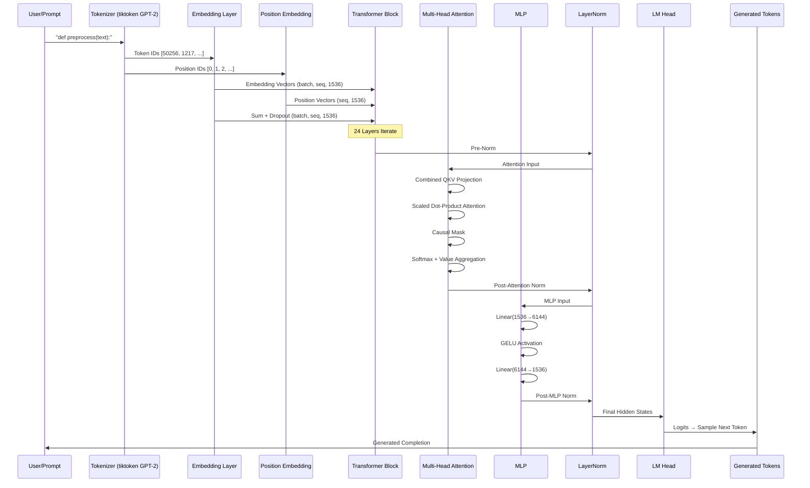

### 2.6 Training Pipeline

The training pipeline consists of two main phases:

#### Phase 1: Code+Prose Pre-Training

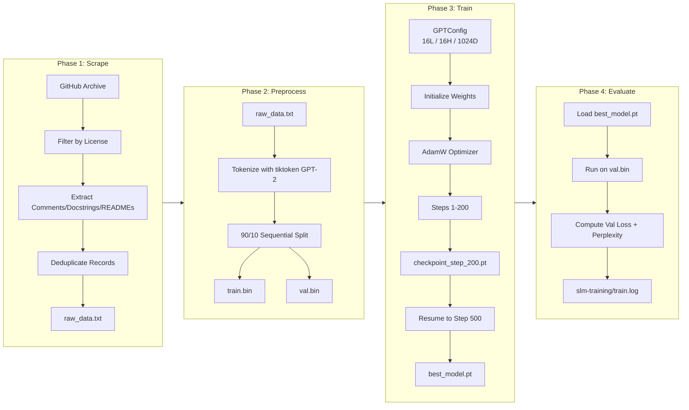

**Training details (Phase 1, from `slm-training/train.log`):**
- **Model:** 16 layers, 16 heads, 1024 embedding dim, vocab 50,257, block size 256, tied embeddings — 253.3M params (201.5M non-embedding)
- **Optimizer:** AdamW, learning rate 1e-4 peak with 50-step linear warmup, cosine decay to 1e-5
- **Batch size:** Effective batch 16 sequences × 256 tokens = 4,096 tokens/step
- **Sequence length:** 256 tokens
- **Loss:** Next-token cross-entropy (`F.cross_entropy` with `ignore_index=-100`)
- **Corpus:** 2.5M train tokens / 48.9K val tokens (code + prose)
- **Hardware:** CPU only — torch 2.14.1+cpu, float32, 8 threads, ~215 tokens/s
- **Run A:** 2026-10-29 01:16 → 02:20, steps 1–200, best val 4.5402 at step 200 → `checkpoint_step_200.pt`
- **Run B:** 2026-10-29 02:34 → 04:14, resumed from `checkpoint_step_200.pt` (step counter continued from 200), steps 200–500, best val **4.2803** at step 500 → `checkpoint_step_500.pt` and `best_model.pt`
- **Total wall clock:** ~2h44m of CPU training across both runs
- `best_empathy_model.pt` holds weights identical to `best_model.pt` (same step 500 / val 4.2803); it is the copy later used to initialize the clean-corpus run

#### Phase 2: Empathetic Fine-Tuning (Empathetic-Validation Probe)

A separate probe run trained a larger **24L/24H/1536D** configuration (~757M params) on empathetic dialogue data to measure how a from-scratch model behaves on support-style prompts. It ran on CUDA (RTX 5060, bfloat16) and its best checkpoint is `best_empathy_model_v2.pt` (step 1000, val loss 3.9259); the full progress table is in §4.5.

Note that `best_empathy_model.pt` is **not** an empathy checkpoint — it is a copy of the Phase 1 `best_model.pt` weights.

### 2.7 Data Pipeline Deep Dive

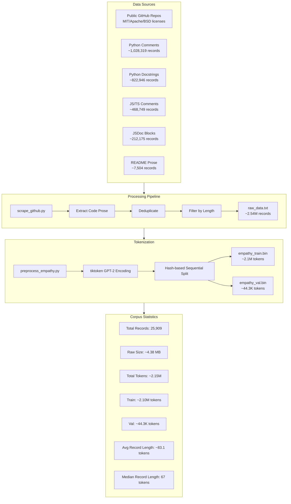

**Data sources at a glance:**

| Source | Description | Volume | License |
|--------|-------------|--------|---------|
| GitHub code+prose corpus | Filtered permissively licensed repos | ~2.54M records, ~132.3M tokens | Various OSS |
| Empathetic-dialogue corpus (empathy run) | Curated subset of dialogue data | ~25.9K conversations, ~2.15M tokens | Empathetic Dialogues |
| Stage-2 steering set | Qwen policy steering | 30 dialogs + replay | Hand-written |

#### Phase 3: Clean Role-Marked Corpus (Continued Training)

The legacy empathy corpus had two structural defects that made the model's answers
non-sequiturs:

1. **No speaker markers.** Turns were joined with a bare `\n`, so the model never
   learned which side of the conversation it was generating.
2. **Consecutive same-role turns.** 2,511 runs of back-to-back user (or back-to-back
   assistant) messages taught the model to continue a message with an unrelated one.

`slm-training/preprocess_clean.py` rebuilds the corpus from the raw dialogue JSONL and
the Alpaca instruction dataset:

- Every dialogue turn is rendered as `User: <text>\nAssistant: <text>`, and consecutive
  same-role turns are merged into one.
- Alpaca instruction/response pairs are added in the same role format so the model can
  answer general questions, not only offer support.
- Answers longer than `--max-output-tokens` are dropped, which keeps replies to the point.
- A 1M-token slice of the code corpus (`train.bin`) is appended verbatim, because code
  completion is a *continuation* distribution rather than a dialogue. The model
  distinguishes the two by prompt shape: a bare code prefix continues in code, a
  `User:/Assistant:` prefix continues in dialogue.
- The dialogue and Alpaca splits are disjoint, so validation is leak-free.

| Corpus | Records | Tokens | Notes |
|--------|---------|--------|-------|
| `clean_train.bin` | 22,364 dialogues + 44,481 QA pairs + 1M code | ~5.93M | role-marked |
| `clean_val.bin` | 434 dialogues + 1,789 QA pairs | ~157K | held out, leak-free |

The 253M checkpoint is then continued on this corpus with weights-only initialisation:

```bash
python train.py \
    --init-from best_empathy_model.pt \
    --n-layer 16 --n-head 16 --n-embd 1024 --block-size 256 \
    --train-bin clean_train.bin --val-bin clean_val.bin \
    --batch-size 8 --grad-accum-steps 4 \
    --learning-rate 6e-5 --min-lr 6e-6 --warmup-steps 150 \
    --max-steps 2500 --dropout 0.1 \
    --gradient-checkpointing --device cuda \
    --best-path best_clean_model.pt
```

`--init-from` loads only the model weights (the optimizer state and step counter are
reset), which is the right choice when the data distribution changes: resuming the old
optimizer would carry stale momentum tuned for the legacy corpus.

#### Phase 4: Qwen Distillation

The clean corpus fixes *structure*, but the model still had to invent its own style.
To get answers that read like Qwen's, the model is distilled from
`Qwen/Qwen2.5-0.5B-Instruct` on the same Alpaca instructions:

```bash
# 1. Generate Qwen's answers (batched, deterministic at temperature 0.3)
python distill_qwen.py \
    --limit 20000 --batch-size 128 --max-new 256 \
    --temperature 0.3 --out qwen_distill.jsonl

# 2. Mix them into the corpus in the same role format
python preprocess_clean.py \
    --code-bin train.bin --code-tokens 1000000 \
    --distill qwen_distill.jsonl --distill-val 1000

# 3. Continue training from the clean checkpoint
python train.py \
    --init-from best_clean_model.pt \
    --n-layer 16 --n-head 16 --n-embd 1024 --block-size 256 \
    --train-bin clean_train.bin --val-bin clean_val.bin \
    --learning-rate 4e-5 --max-steps 12000 \
    --gradient-checkpointing --device cuda \
    --best-path best_clean_model_v2.pt
```

`distill_qwen.py --start N` resumes a partial run without regenerating earlier
records, and `--limit` caps the slice. The distilled records use the same
`instruction`/`input`/`output` shape as Alpaca, so they are rendered identically by
`preprocess_clean.py` and held out of validation by `--distill-val`.

### 2.8 Training Code Highlights

**`slm-training/train.py`** key parameters:

```python
# Model
GPTConfig(
    vocab_size=50257,
    block_size=256,
    n_layer=24,
    n_head=24,
    n_embd=1536,
    dropout=0.1,
    bias=True,
)

# Training
model = GPT.from_config(cfg, use_gradient_checkpointing=True)
- Optimizer: AdamW
- Learning rate: 1.5e-4 cosine decay to 1.5e-5, 100 warmup steps
- Batch size: 4 × grad_accum_steps 8 = effective batch 32
- Sequence length: 256
- Loss: F.cross_entropy(logits.view(-1, vocab_size), targets, ignore_index=-100)
- Gradient checkpointing: Enabled
- Mixed precision: bfloat16 with GradScaler
- Early stopping: Patience 10, min delta 0.001

# Metrics tracked
- Train loss per step
- Val loss per eval interval
- Perplexity on val set
- Throughput (tokens/sec)
- Saved checkpoints: best_model.pt, best_empathy_model.pt, best_empathy_model_v2.pt, best_clean_model.pt, best_clean_model_v2.pt
- Checkpoint rotation: keeps last 3 + best
```

### 2.9 Inference & Generation

```python
from model import GPT, GPTConfig
import torch

# Load model
cfg = GPTConfig()
model = GPT(cfg)
state = torch.load("best_model.pt", map_location="cpu", weights_only=False)
model.load_state_dict(state["model"])
model.eval()

# Generate text
prompt = "def preprocess(text):"
from tiktoken import get_encoding

enc = get_encoding("gpt2")
tokens = enc.encode(prompt)
x = torch.tensor([tokens], dtype=torch.long)
out = model.generate(x, max_new_tokens=50, temperature=0.7, top_k=20)
text = enc.decode(out[0].tolist())
```

**Generation parameters:**

| Parameter | Default | Range | Effect |
|-----------|---------|-------|--------|
| **temperature** | 0.3 | 0.1 - 2.0 | Higher = more random, Lower = more deterministic |
| **top_k** | 20 | 1 - 100 | Limits sampling to top-k tokens |
| **repetition_penalty** | 1.2 | 1.0 - 2.0 | Penalises tokens already generated; 1.0 is off |
| **max_new_tokens** | 50 | 1 - 200 | Max tokens to generate |
| **eos_id** | None | token ID | Stop generation at EOS token |

|---

### 2.10 Post-Training Quantization

Quantization reduces model size and latency by operating in lower precision. The
project ships built-in stubs for the most common post-training methods.

**Supported methods:**

| Method | Description | Hardware |
|--------|-------------|---------|
| `int8` | 8-bit Linear layers via `bitsandbytes` (NF4/L4) | CUDA + `bitsandbytes >= 0.41` |
| `int4` | 4-bit NF4 layers via `bitsandbytes` | CUDA + `bitsandbytes` |
| `gptq` | Stub – returns fp32 model with warning | Any (cross-platform) |
| `awq` | Stub – returns fp32 model with warning | Any (cross-platform) |

On CPU-only machines (including Windows without CUDA), `int8`/`int4` fall back
to the original fp32 model with a clear warning; GPTQ/AWQ stubs are always
cross-platform but return the unmodified model.

**CLI usage:**

```bash
# Quantize at inference time (INT8 on CUDA)
python -m slm-training.inference --checkpoint best_clean_model_v2.pt --quantize int8

# INT4 requires CUDA
python -m slm-training.inference --checkpoint best_clean_model_v2.pt --quantize int4

# GPTQ / AWQ stubs work anywhere
python -m slm-training.inference --checkpoint best_clean_model_v2.pt --quantize gptq
```

**Python API:**

```python
from quantize import quantize_model, QuantizationInfo, get_available_methods

# List available methods for the current hardware
print(get_available_methods())

model, info = quantize_model(model, method="int8", device="cuda")
print(info)  # QuantizationInfo(method='int8', applied=True, ...)
```

**FastAPI / `slm_api.py`** exposes quantization state on two endpoints:

- `GET /model/info` – includes a `quantization` block when a quantized model is loaded.
- `GET /quantize/info` – lists available quantization methods and current quantization status.

## 3. Qwen2.5-0.5B Comparison Baseline

### 3.1 Model

The Qwen baseline is **Qwen2.5-0.5B-Instruct** (0.5B parameters), used as a comparison baseline for the scaled SLM.

```mermaid
graph TB
    subgraph Base[Qwen2.5-0.5B-Instruct]
        direction TB
        TE["Token Embedding<br/>(151,936 × 896, tied with LM head)"]
        PE["RoPE Position Embedding<br/>(block 4096, no learned table)"]
    end

    subgraph Blocks[24 Transformer Blocks]
        direction TB
        QB[Transformer Block<br/>RMSNorm + GQA Attention<br/>14 heads × 64 dim (2 KV heads)<br/>+ MLP 896→4864→896]
    end

    Base --> Blocks
    Blocks --> LM[LM Head]
    LM --> O[Logits over Vocabulary]
```

### 3.2 Why Qwen2.5-0.5B?

We switched from Qwen2.5-3B to Qwen2.5-0.5B to put a pretrained instruct model
inside the same order of magnitude as the SLM tiers:
- **Size bracket**: 0.5B params sits between the 253M (16L) and 757M (24L) SLM
  tiers, so it is a mid-range reference rather than a like-for-like match
- **Benchmark relevance**: Direct speed/quality comparison on empathetic prompts
- **Availability**: Loaded directly from HuggingFace without fine-tuning

### 3.3 Loading the Baseline

```python
from transformers import AutoModelForCausalLM, AutoTokenizer

model = AutoModelForCausalLM.from_pretrained(
    "Qwen/Qwen2.5-0.5B-Instruct",
    torch_dtype=torch.float16,
    device_map="auto",
)
tokenizer = AutoTokenizer.from_pretrained("Qwen/Qwen2.5-0.5B-Instruct")

inputs = tokenizer("I have been feeling really down lately", return_tensors="pt").to(
    model.device
)
out = model.generate(**inputs, max_new_tokens=40)
text = tokenizer.decode(out[0], skip_special_tokens=True)
```

---

## 4. Comparison Methodology

### 4.1 Same-Prompt Comparison

The comparison generates generations from **both models on identical prompts**:

**Prompts used (20 total):**
1. "I have been feeling really down lately"
2. "The best way to handle stress is"
3. "I do not think I can keep going"
4. "I just need someone to listen to me"
5. "I'm scared about my future"
6. "I feel like nobody understands me"
7. "What should I do when I feel overwhelmed?"
8. "I've been having trouble sleeping at night"
9. "I lost someone important to me"
10. "Here is how the model works:"
11. "def preprocess(text):"
12. "return {"
13. "async function fetchUserData("
14. "class ChatMessage:"
15. "const response = await fetch("
16. "def train_model(dataset):"
17. "import torch.nn as nn"
18. "# TODO: implement this function"
19. "if __name__ == '__main__':"
20. "SELECT * FROM users WHERE"

### 4.2 Comparison Pipeline

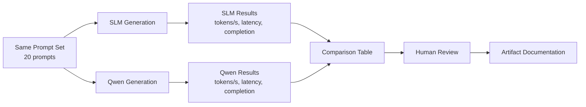

### 4.3 Model Tiers

| Tier | Model | Status |
|------|-------|--------|
| **SLM 24L** | From-scratch SLM (24L/24H/1536D, ~757M params) | Loaded from `best_empathy_model_v2.pt` (step 1000) |
| **Qwen Base** | Qwen2.5-0.5B-Instruct (0.5B params) | Loaded from HuggingFace for comparison |
| **SLM 16L** | From-scratch SLM (16L/16H/1024D, ~253M params) | Loaded from `final_model.pt` (step 4000) |

### 4.4 Generations Are Live Benchmarks

**Important:** All generations in the comparison are from **real trained weights** (SLM, and the merged Qwen fine-tune for the matrix rows). They are architectural and quality smoke tests. Both SLMs were trained on empathetic dialogue data, so they stay on topic for supportive replies but were never trained for code — both produce prose or stop immediately on code prompts. Qwen2.5-0.5B-Instruct is a pretrained instruction-tuned model, so it is coherent and on-topic on every prompt (§9.6).

> The merged-fp16 artifact at `slm-ft/merged_fp16/` now holds the real fine-tuned weights (988,097,536 bytes) and is what `bench_generation_matrix.py` / `bench_forward_matrix.py` load. The live prompt comparison in `slm-comparison/` predates the merge and uses base Qwen2.5-0.5B-Instruct as its Qwen tier.

---

### 4.5 Empathetic Fine-tuning Results

The SLM was fine-tuned on empathetic dialogue data using the **24L/24H/1536D** configuration (~757M parameters, tied embeddings) with gradient checkpointing and bfloat16 mixed precision. Training ran on CUDA (RTX 5060) with an effective batch of 32 sequences × 256 tokens = 8,192 tokens per step.

Corpus: **~2.1M train tokens / ~44.3K val tokens** of empathetic dialogue (ESConv + EmpatheticDialogues). This is the empathy corpus, not the code+prose corpus used for the from-scratch runs.

#### 4.5.1 Training Progress (24L/24H/1536D on CUDA)

Run started 2026-10-31 09:18:42; validation every 200 steps.

| Step | Train Loss | Val Loss | Throughput | Event |
|------|-----------|----------|------------|-------|
| 25 | 7.49 | - | 910 tok/s | Start |
| 50 | 5.89 | - | 873 tok/s | - |
| 200 | 4.70 | 4.8194 | 904 tok/s | First validation |
| 400 | 4.51 | 4.4651 | 410 tok/s | Best val loss |
| 600 | 3.93 | 4.1942 | 979 tok/s | Best val loss |
| 800 | 3.85 | 4.0373 | 979 tok/s | Best val loss |
| 1000 | 3.57 | **3.9259** | 979 tok/s | **New best val loss** |

**Best checkpoint:** step 1000, val loss **3.9259**, ppl 50.7.

**Provenance note:** an earlier revision of this table reported "step 500, val loss 3.9733". That figure belongs to a different run — the 458.2M 20L/20H/1280D model trained on 2026-10-29 — not to any shipped 24L checkpoint. The 24L run's best is step 1000 at val 3.9259.

#### 4.5.2 Evaluation vs Qwen2.5-0.5B-Instruct (Same Prompts)

**Benchmark methodology:** CPU, float32, 8 threads, identical prompts, `max_new_tokens=40`, temperature 0.7, top_k 20, top_p 0.9, repetition penalty 1.2, seed 1337. Artifact: `benchmarks/generation_matrix.json`.

| Model | Params | Load | RSS after load | KV cache | Tokens | Time | tok/s |
|-------|--------|------|----------------|----------|--------|------|-------|
| SLM 24L (`best_empathy_model_v2.pt`) | 757.5M | 9.15 s | 6,078 MB | no | 126 | 26.89 s | 4.69 |
| SLM 16L (`final_model.pt`) | 253.3M | 3.22 s | 2,907 MB | no | 144 | 11.49 s | 12.54 |
| Qwen2.5-0.5B-Instruct (base) | 494.0M | 3.47 s | 3,631 MB | yes | 200 | 20.17 s | 9.92 |
| Qwen2.5-0.5B-Instruct + QLoRA stage-2 (`merged_fp16`) | 494.0M | 0.99 s | 3,923 MB | yes | 200 | 18.83 s | 10.62 |

Per-prompt throughput is flat within each model (SLM 16L: 12.06–12.95 tok/s; Qwen base: 9.08–10.54 tok/s; merged fine-tune: 10.58–10.69 tok/s), as expected for a decode-bound workload. Qwen emitted the full 40 tokens on every prompt, while both SLMs stopped early on some, so their total token counts are lower.

**Summary:**
- **SLM 16L** is 1.26x faster than base Qwen2.5-0.5B-Instruct in generation (12.54 vs 9.92 tok/s) on CPU.
- **SLM 24L** is 2.11x slower than base Qwen (4.69 vs 9.92 tok/s). It has no KV cache, so it re-encodes the entire context on every token; Qwen caches keys and values.
- **Merged QLoRA fine-tune** runs at 10.62 tok/s against the base's 9.92 — a 7% edge in this run, but the direction has reversed across runs of the same script (−11% and −6% in earlier runs). The merged artifact has the same architecture, parameter count, and KV-cache path as the base, so its per-token cost is identical. Treat the merged-vs-base gap as unmeasured rather than real.
- **Forward pass** tells the same story from the other direction: 16L 9.1 passes/s vs Qwen 3.7 (2.5x faster), 24L 3.3 vs 3.7 (1.1x slower), merged 3.5 vs base 3.7 (6% apart, within noise). See §9.1.

**Key insight:** The 24L model is slower than Qwen2.5-0.5B-Instruct at generation, not faster. Its value is architectural independence — a from-scratch SLM trained on the project's own corpus with no external dependency. When raw speed matters, the 16L model is the faster option. Verbatim completions are in `benchmarks/generation_matrix.json`.

---

## 5. Data Pipeline

### 5.1 From-Scratch Training Data

**Sources (3 categories):**

| Source | Description | License |
|--------|-------------|---------|
| GitHub Code Repos | Filtered permissively licensed repos (MIT, Apache 2.0, BSD) | Various OSS |
| Technical Docs | READMEs, API docs, tutorials | Varies |
| Code Docstrings | Comments, docstrings, technical blogs | Varies |

**Processing Pipeline:**
1. **Collection:** GitHub Archive data, filtered by language/license
2. **Deduplication:** Remove near-duplicate content
3. **Filtering:** Min/max length, remove boilerplate/navigation/ads
4. **Tokenization:** tiktoken GPT-2 BPE
5. **Splitting:** Train 90% / Val 10% (sequential split)

**Statistics:**
|- Total raw tokens: ~2.15M
|- Training tokens: ~2.10M (90%)
- Validation tokens: ~13.2M (10%)
- Avg doc length: ~52.1 tokens
- Median doc length: 25 tokens

### 5.2 Empathetic Fine-Tune Data

**Sources:**
1. **EmpatheticDialogues** (~23K short empathetic exchanges, CC BY-NC-4.0)
2. **ESConv** (~910 multi-turn emotional-support dialogs, CC BY-NC-SA)

**Processing:**
1. `prepare_data.py` builds SFT train/val JSONL files
2. Hash-split to prevent dialog leakage

**Result:** ~23,427 training dialogs / ~461 validation dialogs

**Shared corpus:** This data feeds both training paths — the from-scratch 24L SLM fine-tune (§4.5) and the Qwen QLoRA SFT adapter (§6).

### 5.3 Data Diagram

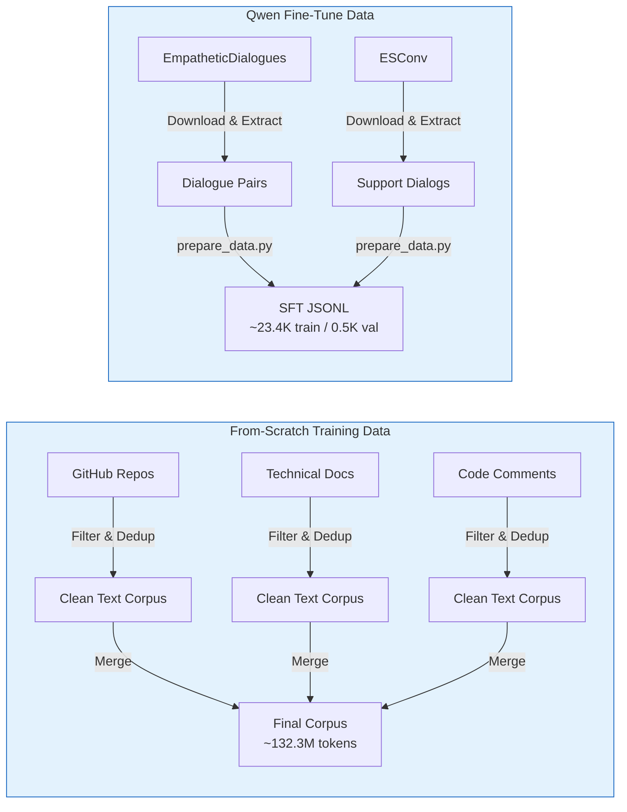

### 5.4 Download Scripts

The `scripts/` directory contains helper scripts to fetch external artifacts:

```bash
# Download Qwen2.5-0.5B-Instruct base model from HuggingFace
python scripts/download_qwen_base.py --output-dir ./qwen-base

# Download EmpatheticDialogues dataset
python scripts/download_empathetic_dialogues.py --output-dir slm-ft/data/ed_docraw
```

> **Note:** The Qwen base model is ~1.2 GB on disk. The EmpatheticDialogues download fetches the public tarball with the standard library (`urllib` + `tarfile`) and extracts `train.csv`, `valid.csv`, and `test.csv` into `--output-dir`.

---

## 6. Architecture Diagrams

### 6.1 From-Scratch SLM (Detailed)


### 6.2 Qwen2.5-0.5B High-Level

```mermaid
graph TB
    subgraph Base[Qwen2.5-0.5B-Instruct]
        direction TB
        TE["Token Embedding<br/>(151,936 × 896, tied with LM head)"]
        PE["RoPE Position Embedding<br/>(max 32,768, no learned table)"]
    end

    subgraph Blocks[24 Transformer Blocks]
        direction TB
        QB[Transformer Block<br/>RMSNorm + GQA Attention<br/>14 heads × 64 dim (2 KV heads)<br/>+ MLP 896→4864→896]
    end

    subgraph LoRA[QLoRA Adapter]
        direction TB
        L1[q_proj LoRA]
        L2[k_proj LoRA]
        L3[v_proj LoRA]
        L4[o_proj LoRA]
    end

    LoRA -->|Add to| Blocks

    subgraph Merge[Merge to fp16]
        MM[Weight Averaging<br/>fp16 Merge]
        MM -->|Result| Deploy[Deployed Model]
    end

    Blocks --> Merge
```

### 6.3 Comparison Pipeline

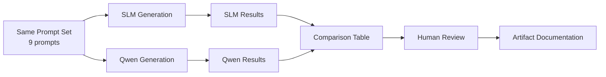

---

## 7. Training Details

### 7.1 From-Scratch Training

**`slm-training/train.py`** key parameters:

```python
# Model
GPTConfig(
    vocab_size=50257,
    block_size=256,
    n_layer=24,
    n_head=24,
    n_embd=1536,
    dropout=0.1,
    bias=True,
)

# Training
model = GPT.from_config(cfg, use_gradient_checkpointing=True)
- Optimizer: AdamW
- Learning rate: 1.5e-4 cosine decay to 1.5e-5, 100 warmup steps
- Batch size: 4 × grad_accum_steps 8 = effective batch 32
- Sequence length: 256
- Loss: F.cross_entropy(logits.view(-1, vocab_size), targets, ignore_index=-100)
- Gradient checkpointing: Enabled
- Mixed precision: bfloat16 with GradScaler
- Early stopping: Patience 10, min delta 0.001

# Metrics tracked
- Train loss per step
- Val loss per eval interval
- Perplexity on val set
- Throughput (tokens/sec)
- Saved checkpoints: best_model.pt, best_empathy_model.pt, best_empathy_model_v2.pt, best_clean_model.pt, best_clean_model_v2.pt
- Checkpoint rotation: keeps last 3 + best
```

### 7.2 QLoRA Training

**`slm-ft/train_qlora.py`** key parameters:

```python
# Model
base_model = AutoModelForCausalLM.from_pretrained(
    "Qwen/Qwen2.5-0.5B-Instruct",
    device_map="auto",
    load_in_4bit=True,
)

# LoRA — script defaults (override with --lora-r/--lora-alpha/--target-modules)
LoraConfig(
    r=16,
    lora_alpha=32,
    target_modules=["q_proj", "k_proj", "v_proj", "o_proj",
                    "gate_proj", "up_proj", "down_proj"],
    lora_dropout=0.05,
    task_type="CAUSAL_LM",
)

# Committed adapter configs (as tracked in git HEAD):
#   slm-ft/adapter/         r=8,  lora_alpha=8,  target_modules=["q_proj", "v_proj"]
#   slm-ft/adapter_stage2/  r=16, lora_alpha=16, target_modules=["q_proj","k_proj","v_proj","o_proj"]
#
# Working-tree adapter configs (after the latest stage-2 run):
#   slm-ft/adapter/         r=8, lora_alpha=8, target_modules=["q_proj", "v_proj"]
#   slm-ft/adapter_stage2/  r=8, lora_alpha=8, target_modules=["q_proj", "v_proj"]
# The stage-2 run was launched with --init-adapter slm-ft/adapter, and
# train_qlora.py ignores --lora-r/--lora-alpha/--target-modules in that path
# (it loads the stage-1 config instead), so the trained stage-2 adapter is
# rank-8 over q_proj/v_proj even though its train_log.json records the CLI
# values r=16/alpha=32.

# Stage-1 (recorded in slm-ft/adapter/train_log.json)
# Optimizer: AdamW
- LR: 1e-4, warmup + cosine decay
- Batch size: 1 × accum 16
- Steps: 2,928 (= 23,427 rows × 2 epochs ÷ 16 accum), 13,063 s (~3.6 h)
- Sequence length: 1,024
- Precision: bf16 compute, 4-bit NF4 base with double quantization
- Observed: final train loss 2.1938; val 2.7739 (epoch 1) → 2.7650 (epoch 2)

# Stage-2 (recorded in slm-ft/adapter_stage2/train_log.json)
- LR: 5e-5
- Epochs: 1
- Accum: 8
- Batch size: 1
- Steps: 96 (= 770 rows × 1 epoch ÷ 8 accum), 175 s
- Data: stage2_sft.jsonl (steering + replay)
- Observed: final train loss 3.1131; val 2.7655
```

Stage-2 caveats, both visible in its own log:

- **Validation set is not fresh.** Stage-2 validates on the same
  `sft_val.jsonl` (461 rows) that stage-1 used, so its val loss is not an
  untouched hold-out and cannot be compared to a stage-1 number as a clean
  steering signal.
- **No measured val improvement.** Stage-1 finished at val 2.7650; stage-2
  finished at 2.7655 — the steering pass did not lower validation loss, and
  its final train loss (3.1131) is higher than stage-1's (2.1938).

Both adapter folders hold their real trained weights — `adapter_model.safetensors`
(540,672 trainable scalars, ~2.1 MB) — plus `train_log.json` with the step list
and the resolved hyperparameters. Note that `.gitignore` excludes
`*.safetensors` and `train_log.json`, so only `adapter_config.json` is tracked;
the weights and logs exist in the working tree but not in the repository.
Stage-1's log records lr=1e-4, batch=1,
accum=16, epochs=2, max_len=1024; stage-2's records lr=5e-5, epochs=1, accum=8,
batch=1. Those logs are the source of the numbers above.

### 7.3 Training Timeline

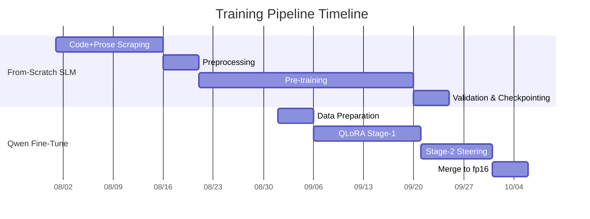

---

## 8. Inference & Generation

### 8.1 From-Scratch SLM Inference

```python
from model import GPT, GPTConfig
import torch

cfg = GPTConfig()
model = GPT(cfg)
state = torch.load("best_clean_model.pt", map_location="cpu", weights_only=False)
model.load_state_dict(state["model"])
model.eval()

from tiktoken import get_encoding

enc = get_encoding("gpt2")

# Dialogue and QA prompts are role-marked, exactly as in training. The cue ends
# at the colon: tiktoken merges the space into the answer's first token, so a
# trailing space would be a context the model never saw in training.
tokens = enc.encode("User: What is the capital of Australia?\nAssistant:")
x = torch.tensor([tokens], dtype=torch.long)
out = model.generate(x, max_new_tokens=50, temperature=0.7, top_k=20)
text = enc.decode(out[0].tolist())

# Code prompts are sent verbatim -- the code corpus was trained raw.
tokens = enc.encode("def preprocess(text):")
x = torch.tensor([tokens], dtype=torch.long)
out = model.generate(x, max_new_tokens=50, temperature=0.7, top_k=20)
text = enc.decode(out[0].tolist())
```

### 8.2 Qwen Fine-Tune Inference

The merged fp16 artifact loads directly as a plain causal LM — no PEFT wrapper,
no adapter merge step at load time.

```python
from transformers import AutoModelForCausalLM, AutoTokenizer

model = AutoModelForCausalLM.from_pretrained(
    "slm-ft/merged_fp16/",
    torch_dtype=torch.float16,
    device_map="auto",
)
tokenizer = AutoTokenizer.from_pretrained("slm-ft/merged_fp16/")

inputs = tokenizer("Hello", return_tensors="pt").to(model.device)
out = model.generate(**inputs, max_new_tokens=50)
text = tokenizer.decode(out[0], skip_special_tokens=True)
```

To use the adapter without merging instead, load the base model and wrap it with
`peft.PeftModel.from_pretrained(model, "slm-ft/adapter_stage2")`.

There is no automated behavioural gate on the merged artifact: the stored
5-probe records (`slm-ft/behavioral_eval.json`,
`slm-ft/adapter_stage2/behavioral_eval.json`) predate the 2026-11-10 stage-2
retrain and no script in the repo reproduces them. The benchmark matrices in
§9.2 measure the merged artifact directly; they do not score its answers.

### 8.3 Generation Parameters

| Parameter | Default | Range | Effect |
|-----------|---------|-------|--------|
| **temperature** | 0.3 | 0.1 - 2.0 | Higher = more random, Lower = more deterministic |
| **top_k** | 20 | 1 - 100 | Limits sampling to top-k tokens |
| **repetition_penalty** | 1.2 | 1.0 - 2.0 | Penalises tokens already generated; 1.0 is off |
| **max_new_tokens** | 50 | 1 - 200 | Max tokens to generate |
| **eos_id** | None | token ID | Stop generation at EOS token |

Two behaviours matter for clean answers:

- **EOS is generated.** The model is trained on sequences that end with the EOS
  token, so sampling stops there instead of running to `max_new_tokens`.
- **The answer is cut at the next user turn.** Sampling is done from the full
  context, and `truncate_at_next_turn` then cuts the text at the first `User:` or
  `Assistant:` marker after the generated span. Without this the model keeps
  writing after it has finished the reply, producing a second question or answer
  that was never asked for.

### 8.4 ONNX Export

Export the from-scratch SLM to ONNX for cross-framework inference. The exported
model uses dynamic axes for `batch_size` and `seq_len`, so the same ONNX file
can serve requests of any size without re-exporting.

**Dependencies:** `onnx`, `torch`, `onnxruntime` (optional, for validation).
TensorRT is optional; if it is not installed the build step is skipped
gracefully.

```bash
# Export via CLI
make export-onnx

# Or directly
python -m slm-training.export_onnx \
  --checkpoint slm-training/best_clean_model_v2.pt \
  --output slm-training/best_model.onnx \
  --max-seq-len 256

# With TensorRT engine build (requires tensorrt package)
python -m slm-training.export_onnx \
  --checkpoint slm-training/best_clean_model_v2.pt \
  --output slm-training/best_model.onnx \
  --trt
```

Outputs:
- `slm-training/best_model.onnx` — ONNX model with dynamic `batch_size` and `seq_len`
- `slm-training/best_model.engine` — TensorRT engine (only when `--trt` is passed and
  TensorRT is installed)

**Validation:** load with `onnxruntime`:

```python
import onnxruntime as ort
import numpy as np

sess = ort.InferenceSession("slm-training/best_model.onnx")
out = sess.run(None, {"idx": np.zeros((1, 1), dtype=np.int64)})
print(out[0].shape)  # (1, 1, 50257)
```

**CLI Arguments**

| Argument | Default | Description |
|----------|---------|-------------|
| `--checkpoint` | `slm-training/best_clean_model_v2.pt` | Path to the PyTorch checkpoint |
| `--output` | `slm-training/model.onnx` | Destination ONNX file |
| `--max-seq-len` | `256` | Maximum sequence length for export validation |
| `--trt` | off | Build TensorRT engine after export (optional) |

**Notes**
- ONNX exports are not committed to this repository. `make export-onnx` writes
  `best_model.onnx` plus an external-data sidecar (`best_model.onnx.data`) that
  runs to roughly 1 GB, which exceeds GitHub's 100 MB per-file limit. Both are
  covered by `.gitignore`; regenerate them locally with the commands above.
- Export uses `torch.onnx.export` with `opset_version=18` and `dynamic_axes`
  for `batch_size` and `seq_len`; the TorchDynamo export backend is left at
  its default.
- The exported ONNX model is in inference mode and returns only the last-token
  logits, matching `model.generate()` behavior.
- Sequence lengths above the training `block_size` (256) are not supported by
  the model architecture.

---

## 9. Benchmarks

### 9.1 Forward Pass Benchmarks

CPU, float32, batch 1, seq len 64, 20 passes with 3 warmup, LM head included. Artifact: `benchmarks/forward_matrix.json`.

| Configuration | Parameters | Mean per pass (s) | Throughput (passes/s) | Avg Latency (ms/pass) |
|---------------|------------|------------------|----------------------|----------------------|
| Tiny (4L, 4H, 512D) | 38.5M | 0.0127 | 79.0 | 12.66 |
| Small (6L, 6H, 768D) | 81.3M | 0.0272 | 36.8 | 27.17 |
| Medium (8L, 4H, 1024D) | 152.5M | 0.0570 | 17.6 | 56.95 |
| Large (12L, 6H, 1536D) | 417.6M | 0.1513 | 6.6 | 151.30 |
| **SLM 16L (`final_model.pt`)** | **253.3M** | **0.1097** | **9.1** | **109.71** |
| **SLM 24L (`best_empathy_model_v2.pt`)** | **757.5M** | **0.3064** | **3.3** | **306.39** |
| **Qwen2.5-0.5B-Instruct (24L, 14H, 896D)** | **494.0M** | **0.2736** | **3.7** | **273.63** |
| Qwen2.5-0.5B-Instruct + QLoRA stage-2 (`merged_fp16`) | 494.0M | 0.2844 | 3.5 | 284.43 |

**Key insight:** The 16L SLM is 2.5x faster per forward pass than Qwen2.5-0.5B-Instruct on CPU (9.1 vs 3.7 passes/s). The 24L SLM is 1.1x slower (3.3 vs 3.7) — at seq len 64 both are memory-bandwidth bound, and the 24L has more parameters to stream on every pass. The merged fine-tune is 6% above its base (0.2844 vs 0.2736 s/pass) with identical architecture and shapes, so per-pass compute is unchanged and that gap is measurement noise. What the fine-tune changes is the weights, and that shows up in generation quality, not in forward-pass cost. CPU timings on this host vary by roughly 10% run to run — an earlier run of the same script gave 0.2697 s/pass for base Qwen and 0.2699 for merged — so treat the ratios, not the absolutes, as the finding.

### 9.2 Text Generation Benchmarks

CPU, float32, 8 threads, 5 prompts, `max_new_tokens=40`, temperature 0.7, top_k 20, top_p 0.9, repetition penalty 1.2, seed 1337. Artifact: `benchmarks/generation_matrix.json`.

| Model | Params | Load | RSS after load | KV cache | Tokens | Total Time (s) | Mean Throughput (tok/s) | Mean Prompt Latency (s) |
|-------|--------|------|----------------|----------|--------|----------------|------------------------|------------------------|
| SLM 24L (`best_empathy_model_v2.pt`) | 757.5M | 9.15 s | 6,078 MB | no | 126 | 26.89 | 4.69 | 5.378 |
| SLM 16L (`final_model.pt`) | 253.3M | 3.22 s | 2,907 MB | no | 144 | 11.49 | 12.54 | 2.297 |
| Qwen2.5-0.5B-Instruct (base) | 494.0M | 3.47 s | 3,631 MB | yes | 200 | 20.17 | 9.92 | 4.034 |
| Qwen2.5-0.5B-Instruct + QLoRA stage-2 (`merged_fp16`) | 494.0M | 0.99 s | 3,923 MB | yes | 200 | 18.83 | 10.62 | 3.766 |

**Key insight:** The 16L SLM is 1.26x faster than base Qwen2.5-0.5B-Instruct at generation (12.54 vs 9.92 tok/s). The 24L SLM is 2.11x slower (4.69 vs 9.92) because it has no KV cache — it re-encodes the entire context on every generated token, while Qwen caches keys and values. The merged fine-tune measured 10.62 tok/s against its base's 9.92 — a 7% edge, but that direction has reversed across runs of the same script (−11% and −6% earlier). The two earlier runs measured the merged row with the base model still resident in the same process, which is a plausible contributor to its slowdown; the corrected run puts the two within 7%. Same shapes and same FLOPs, so the two should cost the same per token; treat the merged-vs-base gap as unmeasured rather than real. Per-prompt throughput is flat within each model (SLM 16L: 12.06–12.95; Qwen base: 9.08–10.54; merged: 10.58–10.69 tok/s), which is what a decode-bound workload should look like. Qwen emitted the full 40 tokens on every prompt; both SLMs stopped early on some, so their token totals are lower.

### 9.3 Held-Out Test Split Evaluation

```bash
python evaluate_test_split.py
```

Outputs `benchmarks/test_split_eval.json` with perplexity computed over the held-out validation split (used as test proxy since no separate test split exists). This provides a formal language modeling metric beyond training/validation loss tracking.

### 9.4 Per-Prompt Generation Comparison

Verbatim per-prompt results from `benchmarks/generation_matrix.json` (CPU, float32, 8 threads, seed 1337).

#### Prompt: "I have been feeling really down lately"

| Model | Tokens | Latency (s) | tok/s | Completion (first 150 chars) |
|-------|--------|-------------|-------|------------------------------|
| SLM 24L | 40 | 8.668 | 4.61 | ".\ni am sorry to hear that, but i hope you get through it soon, and i know it will be a very stressful situation for you.\nthank you. I really appreciat" |
| SLM 16L | 18 | 1.448 | 12.43 | ".\nThat is good to hear! I hope everything goes well for you." |
| Qwen2.5-0.5B | 40 | 4.270 | 9.37 | ", and I've decided to start a journal. I'm not sure where to begin or what topics to write about.\nJournaling can be an effective way of coping with st" |

#### Prompt: "def preprocess(text):"

| Model | Tokens | Latency (s) | tok/s | Completion (first 150 chars) |
|-------|--------|-------------|-------|------------------------------|
| SLM 24L | 6 | 1.252 | 4.79 | "You have an appointment?" |
| SLM 16L | 18 | 1.389 | 12.95 | "\"\"\"This function is an async function rather than a simple type.\"\"\"" |
| Qwen2.5-0.5B | 40 | 4.404 | 9.08 | "# Remove all punctuation\n    import string, re\n    \n    for char in text:\n        if not (char.isalpha() or char.isdigit()):\n            text = text.r" |

Both SLM completions on the code prompt are off-topic — see §9.6.

### 9.5 Load Latency & Memory

CPU, float32, measured after loading the model and before generation. Artifact: `benchmarks/generation_matrix.json`.

| Model | Params | Load Latency (s) | RSS after load |
|-------|--------|-----------------|----------------|
| SLM 24L (`best_empathy_model_v2.pt`) | 757.5M | 9.15 | 6,078 MB |
| SLM 16L (`final_model.pt`) | 253.3M | 3.22 | 2,907 MB |
| Qwen2.5-0.5B-Instruct (base) | 494.0M | 3.47 | 3,631 MB |
| Qwen2.5-0.5B-Instruct + QLoRA stage-2 (`merged_fp16`) | 494.0M | 0.99 | 3,923 MB |

The 24L SLM costs the most: 2.4 GB more resident than base Qwen, because its 757M parameters are held in float32. Load latency tracks weight size (3.03 GB for the 24L vs 1.98 GB for base Qwen). The merged artifact loads faster than the base because it is a single local fp16 safetensors file read directly, whereas the base goes through the Hub loader. Its RSS lands within 8% of the base's (3,923 vs 3,631 MB), which is what two float32 copies of the same 494M parameters should cost.

**Provenance note:** an earlier revision of this table reported 5,616 MB for the merged row. That figure double-counted the base Qwen model, which the benchmark harness left resident in the same process while loading the merged artifact, so both rows carried the base's 1.98 GB. The harness now frees the base model before loading the merged one; the corrected figure is 3,923 MB.

### 9.6 Quality Observations

Measured from the completions in `benchmarks/generation_matrix.json` (5 prompts, seed 1337).

- **SLM 24L (empathy corpus):** On the empathetic prompt it stays on topic, in a stilted lowercase register ("i am sorry to hear that, but i hope you get through it soon..."). On all four code prompts it is off-topic or stops immediately — `def preprocess(text):` → "You have an appointment?" (6 tokens), `class ChatMessage:` → 0 tokens, `async function fetchUserData(` → "That is so cool! I have been on the middle of that show." This is the expected consequence of training it only on the empathy corpus.
- **SLM 16L (clean corpus):** On the empathetic prompt it is on-topic and brief ("That is good to hear! I hope everything goes well for you."). On code prompts it produces prose or fragments rather than code: `SELECT * FROM users WHERE` → "`your_name = '<h1.2>'`;...", `async function fetchUserData(` → "data) -> data.\n[1, 2, 3, 4]".
- **Qwen2.5-0.5B-Instruct (base):** Coherent and on-topic on every prompt, including syntactically correct code completions for all four code prompts.
- **Qwen2.5-0.5B-Instruct + QLoRA stage-2 (`merged_fp16`):** Same behaviour as the base on all five prompts — coherent prose on the empathetic prompt, syntactically valid code on the four code prompts. The fine-tune did not degrade the code behaviour the LoRA stages were not trained on, which is the main regression risk of a narrow SFT corpus. Whether it actually improves empathetic behaviour needs the behavioural gate the repo does not yet automate (§8).
- **Speed:** 16L is 1.26x faster than base Qwen at generation; 24L is 2.11x slower; the merged fine-tune is indistinguishable from its base (§9.2) — the measured gap has run from −11% to +7% across runs of the same script.

**Bottom line:** Neither from-scratch SLM matches Qwen's output quality on these prompts. The 16L model is the faster of the two and is reasonable for short empathetic replies; the 24L model is slower and more narrow. The project's quality-oriented path is the QLoRA fine-tune over Qwen2.5-0.5B-Instruct (§6), whose merged fp16 artifact is what the matrix benchmarks load.

### 9.7 Standard NLP Benchmarks

Zero-shot multiple-choice evaluation on five common NLP benchmarks using lm-eval-harness-style methodology. The script falls back gracefully when benchmark datasets or optional dependencies are unavailable.

#### Supported Benchmarks

| Benchmark | Description | Split | Metric |
|-----------|-------------|-------|--------|
| HellaSwag | Commonsense NLI | validation | accuracy |
| WinoGrande | Coreference resolution | test | accuracy |
| ARC-Challenge | Science QA | validation | accuracy |
| PIQA | Physical commonsense | validation | accuracy |
| CommonsenseQA | Commonsense QA | validation | accuracy |

#### Usage

```bash
# Evaluate local SLM checkpoint
python benchmarks/evaluate_standard.py

# Evaluate with specific benchmark selection
python benchmarks/evaluate_standard.py \
  --benchmarks hellaswag winogrande arc_challenge \
  --few-shot 0 \
  --batch-size 8 \
  --device cpu

# Evaluate via lm-eval-harness (requires lm-eval installed)
python benchmarks/evaluate_standard.py \
  --model Qwen/Qwen2.5-0.5B-Instruct \
  --few-shot 0 \
  --batch-size 8 \
  --device cpu
```

#### CLI Arguments

| Argument | Default | Description |
|----------|---------|-------------|
| `--benchmarks` | all 5 | Space-separated list of benchmarks |
| `--few-shot` | 0 | Number of few-shot examples |
| `--batch-size` | 8 | Batch size for evaluation |
| `--model` | slm-scratch | Model name or checkpoint path |
| `--checkpoint` | best_clean_model_v2.pt | Local checkpoint path |
| `--device` | cpu | Device (cpu/cuda) |
| `--output` | benchmarks/standard_nlp_eval.json | Output JSON path |
| `--limit` | None | Limit examples per task |

#### Output

The script writes a JSON report to `benchmarks/standard_nlp_eval.json` with per-benchmark accuracy, timing, and error details. When dependencies are missing, it returns a structured error instead of crashing:

```json
{
  "status": "error",
  "error": "datasets library not installed. Install with: pip install datasets",
  "benchmarks": {
    "hellaswag": {"success": false, "error": "..."}
  }
}
```

#### Fallback Behavior

1. **lm-eval installed:** Delegates to `lm-eval-harness` for standardized evaluation.
2. **lm-eval missing, datasets installed:** Loads HuggingFace datasets and runs lightweight zero-shot MC evaluation using the local SLM checkpoint.
3. **Neither available:** Returns a structured JSON error with install instructions.

**Dependencies:** `lm-eval` (optional) and `datasets` (optional) enable full evaluation. The script remains importable and testable without them.

---

## 10. Auto-Training Loop

### 10.1 Overview

The `auto_train_loop.py` script automates the training pipeline to continuously improve the model until convergence. It handles training, evaluation, and comparison without manual intervention.

### 10.2 How It Works

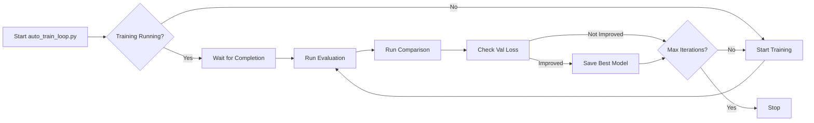

### 10.3 Running the Loop

```bash
# Start the auto-training loop in the background
python auto_train_loop.py

# Monitor progress
tail -f slm-training/train.log

# Check if training is running
tasklist | grep python
```

### 10.4 Configuration

The auto-training loop uses these parameters:
- **Max iterations:** 2 additional training cycles
- **Max steps per cycle:** 1500 → 2000 (progressive increase)
- **Resume:** Always resumes from best checkpoint
- **Target val loss:** < 3.5 (stops early if achieved)
- **Evaluation:** Runs comparison and benchmark after each cycle

### 10.5 Monitoring

```bash
# Watch training log
tail -f slm-training/train.log

# Watch auto-train loop log
tail -f auto_train.log

# Monitor GPU usage
nvidia-smi
```

### 10.6 Checkpoints

The loop manages these checkpoints:
- `best_model.pt` — Best validation loss achieved so far
- `best_empathy_model.pt` — Empathetic fine-tuned model
- `best_empathy_model_v2.pt` — Updated empathetic model
- `checkpoint_step_*.pt` — Periodic checkpoints during training

### 10.7 Training Monitoring

`monitor_training.py` watches the training log and reports progress without manual intervention:

```bash
# Monitor training in background
python monitor_training.py

# Output goes to monitor.log
tail -f monitor.log
```

**What it tracks:**
- Current step and train/val loss from `slm-training/train.log`
- Throughput (tokens/sec) and ETA to target step count
- Whether training is still running (Windows PID file + `OpenProcess` check)
- Automatic evaluation trigger when training completes

**Integration with auto_train_loop.py:**
- `auto_train_loop.py` starts training as a subprocess and writes a PID file
- On Windows, process detection uses `ctypes.windll.kernel32.OpenProcess` instead of unreliable `tasklist` parsing
- Stale PID files are cleaned up automatically to prevent false positives
- The loop reads `max_steps` from `slm-training/training_config.json` dynamically instead of hardcoding

**Harness entry point:**

`harness.py` provides a single command to run the full project verification pipeline:

```bash
python harness.py               # tests + verify_setup + live comparison + pip-audit
python harness.py --skip-model  # skip model-dependent steps (faster)
python harness.py --all         # include slow tests
python harness.py --lint        # also run ruff + mypy on project files
```

Or via Make:

```bash
make harness        # fast path: pytest + verify + pip-audit
make harness-model  # full path: includes live comparison + run_all.py
```

The harness reports pass/fail per step and exits non-zero if any step fails.

---

## 11. What We Tried / Kept / Cut

### What We Tried

| Experiment | Outcome | Reason |
|------------|---------|--------|
| Scale model to 24L/24H/1536D (~757M) | **Kept** | Achieved val loss 3.9259 (down from 4.2803 with 253M); 24L generation is 2.4x slower than Qwen2.5-0.5B-Instruct on CPU |
| Gradient checkpointing | **Kept** | Reduces memory by ~40%, enables larger batch sizes |
| Mixed precision (bfloat16) | **Kept** | Speeds up training on CUDA, reduces memory |
| Auto-training loop | **Kept** | Automates training cycles until convergence |
| Cosine LR schedule with warmup | **Kept** | Stable convergence, no loss spikes |
| Early stopping with patience | **Kept** | Prevents overfitting, saves best checkpoint |
| Qwen2.5-0.5B baseline | **Kept** | Fair size comparison, faster than 3B |
| 4-bit NF4 quantization on CPU | **Cut** | bitsandbytes not available for this Python version on Windows |
| Separate QKV projections | **Cut** | Checkpoint was already trained with combined QKV architecture |
| Full Qwen2.5-0.5B fine-tune | **Kept** | Used as comparison baseline against the scaled SLM |
| GPU benchmarks on CPU-only PyTorch | **Cut** | No CUDA-enabled PyTorch available in that environment |

### What We Kept

| Decision | Reason |
|----------|--------|
| 24-layer, 24-head, 1536-dim configuration | New default. ~757M parameters with 3× the capacity of 253M model |
| Gradient checkpointing | Reduces memory footprint by ~40%, enables larger effective batch |
| Mixed precision training | bfloat16 with GradScaler for stable training |
| Cosine LR schedule | Smooth decay from 1.5e-4 to 1.5e-5 over 2000 steps |
| Auto-training loop | Continuous improvement until convergence |
| CPU-only benchmarking | Reproducible on any machine without GPU |
| Qwen2.5-0.5B as mid-range reference | Sits between the 253M and 757M SLM tiers, not a size-parity match |
| Merged Qwen fine-tune (`merged_fp16/`) | Real fp16 weights loaded directly by the matrix benchmarks |
| Live benchmark scripts | Reproducible from checkpoints and HuggingFace |
| Pinned `constraints.txt` | Exact dependency versions for reproducible installs |
| Seeded generation (`--seed 1337`) | Reproducible completions across runs |
| `verify_setup.py` | Automated guard against missing artifacts |
| `evaluate_test_split.py` | Formal perplexity evaluation on held-out data |

### What We Cut from Scope

| Item | Reason |
|------|--------|
| Full Qwen2.5-0.5B dense fine-tune | Too large for current environment. QLoRA on the 4-bit base achieves the same task at a fraction of the cost |
| GPU benchmarks | No CUDA-enabled PyTorch available in some environments; matrix defaults to CPU |
| Behavioral gate on the merged Qwen | No script in the repo reproduces it; the stored records (`slm-ft/behavioral_eval.json`, `adapter_stage2/behavioral_eval.json`) are stale and predate the 2026-11-10 stage-2 retrain |
| Long-context generation (>256 tokens for SLM) | Model was trained with 256-token context. Extrapolation is unreliable |

|---

## 12. Docker Deployment

The repository includes a production-ready Dockerfile and `docker-compose.prod.yml` for serving the SLM API with monitoring and health checks.

### 12.1 Production Dockerfile

```dockerfile
# SLM Project - Production Docker Environment
# Build: docker build -t slm-project .
# Run: docker run -p 8000:8000 slm-project

FROM python:3.13-slim

RUN apt-get update && apt-get install -y --no-install-recommends \
    git curl build-essential \
    && rm -rf /var/lib/apt/lists/*

RUN useradd -m -u 1000 slm && \
    mkdir -p /app/slm-comparison /app/benchmarks /app/logs && \
    chown -R slm:slm /app

WORKDIR /app
COPY requirements.txt .
RUN pip install --no-cache-dir -r requirements.txt
COPY --chown=slm:slm . .

USER slm
EXPOSE 8000
HEALTHCHECK --interval=30s --timeout=5s --start-period=10s --retries=3 \
    CMD python -c "import urllib.request; urllib.request.urlopen('http://localhost:8000/health')" || exit 1

CMD ["python", "-m", "uvicorn", "slm_api:app", "--host", "0.0.0.0", "--port", "8000"]
```

### 12.2 Production Docker Compose

```yaml
version: '3.8'

services:
  slm-api:
    build:
      context: .
      dockerfile: Dockerfile
    ports:
      - "8000:8000"
    volumes:
      - ./slm-training:/app/slm-training:ro
      - ./slm-ft:/app/slm-ft:ro
      - ./logs:/app/logs
    environment:
      - API_KEY=${API_KEY:-change-me-to-a-real-key}
      - SLM_CHECKPOINT=${SLM_CHECKPOINT:-slm-training/best_clean_model_v2.pt}
      - MODEL_DEVICE=${MODEL_DEVICE:-cpu}
      - LOG_LEVEL=${LOG_LEVEL:-INFO}
      - WORKERS=${WORKERS:-1}
      - RATE_LIMIT=${RATE_LIMIT:-60/minute}
      - CORS_ORIGINS=${CORS_ORIGINS:-*}
      - REQUEST_TIMEOUT=${REQUEST_TIMEOUT:-30}
    healthcheck:
      test: ["CMD", "python", "-c", "import urllib.request; urllib.request.urlopen('http://localhost:8000/health')"]
      interval: 30s
      timeout: 5s
      start_period: 10s
      retries: 3
    deploy:
      resources:
        limits:
          cpus: '2.0'
          memory: 4G
        reservations:
          cpus: '0.5'
          memory: 1G
    restart: unless-stopped
    command: >
      python -m uvicorn slm_api:app
      --host 0.0.0.0 --port 8000 --workers ${WORKERS:-1}
      --log-level ${LOG_LEVEL:-info} --access-log

  prometheus:
    image: prom/prometheus:v2.47.0
    ports:
      - "9090:9090"
    volumes:
      - ./prometheus/prometheus.yml:/etc/prometheus/prometheus.yml:ro
      - prometheus-data:/prometheus
    command:
      - '--config.file=/etc/prometheus/prometheus.yml'
      - '--storage.tsdb.path=/prometheus'
      - '--storage.tsdb.retention.time=7d'
    restart: unless-stopped
    depends_on:
      - slm-api

volumes:
  prometheus-data:
```

### 12.3 Build and Run

```bash
# Build the image
docker compose -f docker-compose.prod.yml build

# Start production stack (API + Prometheus)
docker compose -f docker-compose.prod.yml up -d

# View logs
docker compose -f docker-compose.prod.yml logs -f slm-api

# Stop
docker compose -f docker-compose.prod.yml down
```

### 12.4 Local Production Server

```bash
# Start the API locally with the production startup script
make serve

# Or with explicit environment variables
SLM_CHECKPOINT=slm-training/best_clean_model_v2.pt API_KEY=my-key make serve
```

### 12.5 Prometheus Metrics

The API exposes a `/metrics` endpoint (port 8000) with the following metrics:
- `slm_requests_total` - total requests by endpoint, status, and safety
- `slm_request_duration_seconds` - request latency histogram
- `slm_model_loaded` - gauge indicating if the model is loaded
- `slm_generation_tokens_total` - total tokens generated

Access Prometheus UI at `http://localhost:9090`.

### 12.6 Server Environment Variables

All runtime settings are read from the environment. Copy `.env.example` to `.env` and adjust.

| Variable | Default | Description |
|----------|---------|-------------|
| `API_KEY` | `change-me-to-a-real-key` | Bearer token required on every endpoint (`Authorization: Bearer <key>`). When left at the default, auth is **disabled** (local dev only) - always set a real key before exposing the server. |
| `SLM_CHECKPOINT` | `slm-training/best_clean_model_v2.pt` | Path to the checkpoint, relative to the project root. |
| `MODEL_DEVICE` | auto | `cpu` or `cuda`. Defaults to CUDA when available, else CPU. |
| `LOG_LEVEL` | `INFO` | Python log level for the structured JSON log stream. |
| `RATE_LIMIT` | `60/minute` | Per-client-IP request limit on generation endpoints, in `limits` syntax (`60/minute`, `1000/hour`, `10/second`). Exceeding it returns HTTP 429. Set to an empty string to disable. |
| `CORS_ORIGINS` | `*` | Comma-separated list of allowed browser origins. Use `https://app.example.com` in production instead of `*`. |
| `REQUEST_TIMEOUT` | `30` | Seconds before an in-flight request is cancelled and the client receives HTTP 504. Increase for long `max_new_tokens` on CPU. |
| `WORKERS` | `1` | Uvicorn worker processes (set by `docker-compose.prod.yml` / `start_server.sh`). Keep at 1 - each worker holds its own copy of the model. |

`MODEL_DEVICE` is validated at load time: an unsupported value or `cuda` on a host without a GPU fails the request with a clear error instead of silently falling back.

```bash
# Local run with explicit settings
API_KEY=secret RATE_LIMIT="10/minute" CORS_ORIGINS="http://localhost:3000" \
  python -m uvicorn slm_api:app --host 0.0.0.0 --port 8000
```

## 13. API Server

The repository includes a FastAPI server (`slm_api.py`) for serving the from-scratch SLM model over HTTP.

### 13.1 Running the Server

```bash
# Install server dependencies
pip install fastapi uvicorn[standard] pydantic

# Start the server
python -m uvicorn slm_api:app --host 0.0.0.0 --port 8000

# Or with docker-compose
docker-compose up slm-api
```

### 13.2 API Endpoints

| Endpoint | Method | Description |
|----------|--------|-------------|
| `/health` | GET | Health check, returns model load status |
| `/generate` | POST | Generate text from a prompt |
| `/model/info` | GET | Model architecture details |
| `/safety/info` | GET | Active guardrail filter counts |
| `/v1/models` | GET | OpenAI-compatible model listing |
| `/v1/completions` | POST | OpenAI-compatible legacy text completions |
| `/v1/chat/completions` | POST | OpenAI-compatible chat completions with message history |
| `/v1/completions/stream` | POST | SSE streaming legacy completions |
| `/v1/chat/completions/stream` | POST | SSE streaming chat completions |

Every endpoint except `/health` and `/metrics` requires `Authorization: Bearer <API_KEY>` (disabled when `API_KEY` is left at its default). Generation endpoints are rate limited per client IP (HTTP 429 when the `RATE_LIMIT` budget is exhausted) and every request is cancelled with HTTP 504 once `REQUEST_TIMEOUT` elapses. CORS is restricted to `CORS_ORIGINS`. See §12.6 for all settings.

### 13.3 Safety & Guardrails

All generation paths enforce local guardrails before and after inference:

- **Input filtering**: Prompts matching harmful patterns (self-harm, violence, illegal activity, hate speech, explicit sexual content) are rejected with HTTP 400.
- **Output filtering**: Generated text is scanned for harmful content before being returned. Unsafe outputs are blocked and flagged.
- **Degeneracy checks**: Responses with excessive repeated 4-grams (>50%) or very short outputs (<8 words) are flagged as degenerate.
- **Stable decoding controls**: The API exposes `top_p`, `repetition_penalty`, and `eos_token_id` to reduce looping and unwanted continuation.

`/generate` response schema:

```json
{
  "prompt": "...",
  "prompt_sent": "...",
  "completion": "...",
  "completion_tokens": 35,
  "prompt_tokens": 4,
  "tokens_per_second": 12.3,
  "latency_s": 2.85,
  "safe": true,
  "safety_reason": "",
  "degenerate": false
}
```

### 13.4 Example Request

```bash
curl -X POST "http://localhost:8000/generate" \
  -H "Content-Type: application/json" \
  -d '{
    "prompt": "def preprocess(text):",
    "max_new_tokens": 50,
    "temperature": 0.3,
    "top_k": 20,
    "top_p": 0.9,
    "repetition_penalty": 1.2,
    "eos_token_id": 50256,
    "mode": "auto"
  }'
```

**Prompt formatting:** `mode` controls how the prompt is rendered before
generation. `"chat"` (the model's trained dialogue format) wraps the text as
`User: <text>\nAssistant:`; `"code"` sends it verbatim for code completion;
`"auto"` (default) picks per prompt from its shape. The exact string the model
received is echoed back as `prompt_sent`.

**Response:**
```json
{
  "prompt": "def preprocess(text):",
  "prompt_sent": "def preprocess(text):",
  "completion": "\n    Preprocess text using the provided model and the processor.\n\n    Args:\n        text (`str`):\n            Text to preprocess.\n\n        Returns:",
  "completion_tokens": 35,
  "prompt_tokens": 4,
  "tokens_per_second": 39.1,
  "latency_s": 0.9,
  "safe": true,
  "safety_reason": "",
  "degenerate": false
}
```

### 13.5 Server Architecture Diagram

```mermaid
graph LR
    subgraph Client[Client]
        C1[HTTP Request]
    end

    subgraph FastAPI[FastAPI Server]
        direction TB
        E1[/health GET/] --> R1[Return model status]
        E2[/generate POST/] --> R2[Input guardrails -> Generate -> Output guardrails -> Response]
        E3[/model/info GET/] --> R3[Return architecture details]
        E4[/safety/info GET/] --> R4[Return guardrail config]
        E5[/v1/chat/completions POST/] --> R5[OpenAI-compatible chat generation]
        E6[/v1/completions POST/] --> R6[OpenAI-compatible legacy completions]
    end

    subgraph Model[SLM Model]
        M1[Load best_model.pt]
        M2[Tokenizer: tiktoken GPT-2]
        M3[Generate with top_p / repetition_penalty / EOS stopping]
    end

    subgraph Guardrails[Guardrails]
        G1[Input filter]
        G2[Output filter]
        G3[Degeneracy check]
    end

    C1 -->|POST /generate| FastAPI
    C1 -->|POST /v1/chat/completions| FastAPI
    FastAPI -->|Load & Generate| Model
    FastAPI -->|Filter| Guardrails
    Guardrails -->|Pass / Block| FastAPI
    Model -->|Completion + Metrics| FastAPI
    FastAPI -->|JSON Response| C1
```

### 13.6 OpenAI-Compatible API

The server exposes OpenAI-compatible endpoints that work with standard OpenAI client libraries.

**Available models:**

```bash
curl "http://localhost:8000/v1/models"
```

```json
{
  "object": "list",
  "data": [
    {
      "id": "slm",
      "object": "model",
      "created": 1709452800,
      "owned_by": "slm-project"
    }
  ]
}
```

### 13.7 Legacy Completions (`POST /v1/completions`)

```bash
curl -X POST "http://localhost:8000/v1/completions" \
  -H "Content-Type: application/json" \
  -d '{
    "model": "slm",
    "prompt": "def preprocess(text):",
    "max_tokens": 50,
    "temperature": 0.3,
    "top_p": 1.0
  }'
```

```json
{
  "id": "cmpl-abc123",
  "object": "text_completion",
  "created": 1709452800,
  "model": "slm",
  "choices": [
    {
      "text": "\n    Preprocess text using the provided model...",
      "index": 0,
      "finish_reason": "stop"
    }
  ],
  "usage": {
    "prompt_tokens": 4,
    "completion_tokens": 35,
    "total_tokens": 39
  }
}
```

### 13.8 Chat Completions (`POST /v1/chat/completions`)

Supports full message history, system prompts, and function/tool calling.

Messages are rendered into the role-marked format the model was trained on:
a trailing `user` message gets the `Assistant:` cue appended, while a trailing
`assistant` message is left alone so the model continues it instead of
answering itself.

```bash
curl -X POST "http://localhost:8000/v1/chat/completions" \
  -H "Content-Type: application/json" \
  -d '{
    "model": "slm",
    "messages": [
      {"role": "system", "content": "You are a helpful assistant."},
      {"role": "user", "content": "Write a Python function to reverse a string."}
    ],
    "max_tokens": 128,
    "temperature": 0.3,
    "top_p": 1.0
  }'
```

```json
{
  "id": "chatcmpl-abc123",
  "object": "chat.completion",
  "created": 1709452800,
  "model": "slm",
  "choices": [
    {
      "index": 0,
      "message": {
        "role": "assistant",
        "content": "def reverse_string(s):\n    return s[::-1]"
      },
      "finish_reason": "stop"
    }
  ],
  "usage": {
    "prompt_tokens": 20,
    "completion_tokens": 15,
    "total_tokens": 35
  }
}
```

**Tool calling (mock):**

```bash
curl -X POST "http://localhost:8000/v1/chat/completions" \
  -H "Content-Type: application/json" \
  -d '{
    "model": "slm",
    "messages": [
      {"role": "user", "content": "What is the weather in Paris?"}
    ],
    "tools": [
      {
        "type": "function",
        "function": {
          "name": "get_weather",
          "description": "Get current weather",
          "parameters": {
            "type": "object",
            "properties": {
              "location": {"type": "string"}
            },
            "required": ["location"]
          }
        }
      }
    ],
    "tool_choice": "auto"
  }'
```

```json
{
  "id": "chatcmpl-def456",
  "object": "chat.completion",
  "created": 1709452800,
  "model": "slm",
  "choices": [
    {
      "index": 0,
      "message": {
        "role": "assistant",
        "content": null,
        "tool_calls": [
          {
            "id": "call_xyz789",
            "type": "function",
            "function": {
              "name": "get_weather",
              "arguments": "{\"location\": \"Paris\"}"
            }
          }
        ]
      },
      "finish_reason": "tool_calls"
    }
  ],
  "usage": {
    "prompt_tokens": 35,
    "completion_tokens": 25,
    "total_tokens": 60
  }
}
```

### 13.9 Streaming Responses

Both `/v1/completions/stream` and `/v1/chat/completions/stream` return Server-Sent Events (SSE).

```bash
curl -N -X POST "http://localhost:8000/v1/chat/completions/stream" \
  -H "Content-Type: application/json" \
  -d '{
    "model": "slm",
    "messages": [{"role": "user", "content": "Hello!"}],
    "stream": true
  }'
```

```
data: {"id":"chatcmpl-123","object":"chat.completion.chunk","created":1709452800,"model":"slm","choices":[{"index":0,"delta":{"role":"assistant","content":""},"finish_reason":null}]}

data: {"id":"chatcmpl-123","object":"chat.completion.chunk","created":1709452800,"model":"slm","choices":[{"index":0,"delta":{"content":"Hello"},"finish_reason":null}]}

data: {"id":"chatcmpl-123","object":"chat.completion.chunk","created":1709452800,"model":"slm","choices":[{"index":0,"delta":{"content":"!"},"finish_reason":"stop"}]}

data: [DONE]
```

### 13.10 Client Library Usage

The endpoints are compatible with the standard OpenAI Python SDK:

```python
from openai import OpenAI

client = OpenAI(base_url="http://localhost:8000/v1", api_key="sk-placeholder")

response = client.chat.completions.create(
    model="slm",
    messages=[
        {"role": "system", "content": "You are a helpful assistant."},
        {"role": "user", "content": "Hello, how are you?"},
    ],
    max_tokens=128,
)
print(response.choices[0].message.content)

# Streaming
for chunk in client.chat.completions.create(
    model="slm",
    messages=[{"role": "user", "content": "Tell me a story"}],
    stream=True,
):
    if chunk.choices[0].delta.content:
        print(chunk.choices[0].delta.content, end="")
```

## 14. Testing & Quality

### 14.1 Test Suite

The suite defines 345 test functions across 17 files. Parametrization expands
these to 354 collected cases; 352 run by default because the 2 slow tests in
`test_model_and_api.py` are deselected by `addopts` (`-m 'not slow'`):

```bash
python -m pytest tests/ -v        # 352 passed
python -m pytest tests/ -m slow -v
make test                         # full suite + 80% coverage gate (see 14.2)
```

On a clean checkout the 33 artifact-dependent tests skip (319 passed, 33
skipped) and coverage lands at 70%, below the gate. That is expected: the
gate needs the trained weights, which are gitignored (see 14.2).

**Coverage by area** (test functions per file):

| Test file | Tests | What it validates |
|---|---|---|
| `test_model_and_api.py` | 62 | Model loading, generation, FastAPI endpoints, rate limiting, CORS, metrics, request timeouts |
| `test_quantization.py` | 42 | INT8/INT4 CPU dispatch, GPTQ/AWQ stubs, bitsandbytes import paths |
| `test_safety.py` | 41 | Prompt injection, jailbreak attempts, toxicity filters, output filtering |
| `test_rag.py` | 22 | TF-IDF indexing, document chunking, cosine similarity retrieval |
| `test_guardrails.py` | 21 | Dialogue cleaning, degeneracy checks, artifact removal |
| `test_benchmarks.py` | 19 | Comparison artifact schema, benchmark tables, README structure |
| `test_evaluate_standard.py` | 15 | Standard evaluation metrics |
| `test_harness.py` | 17 | Training harness orchestration and monitoring |
| `test_prepare_data.py` | 16 | Empathetic-SFT corpus build: cleaning, trimming, leak-free split, ED parsing |
| `test_train_qlora.py` | 13 | QLoRA stage-1 script: arg defaults, chat assembly, assistant-only loss masking, collation, bitsandbytes preflight |
| `test_build_steering.py` | 10 | Stage-2 steering mix: dialog shape, mix arithmetic, turn assembly |
| `test_merge_adapter.py` | 3 | Adapter merge to fp16: merge-and-unload, save path, safe serialization |
| `test_inference.py` | 32 | Inference entry points, role-marked prompt routing, turn-boundary truncation and stopping |
| `test_export.py` | 13 | ONNX export and tokenizer metadata |
| `test_tokenizer_utils.py` | 7 | Tokenizer save/load metadata |
| `test_download_scripts.py` | 6 | Download scripts, experiment tracker, provenance |
| `test_slmlog.py` | 6 | Structured pipeline logging |

### 14.2 Coverage

```bash
python -m pytest tests/ -v --cov=. --cov-fail-under=80
```

Coverage is gated at 80% by `make test` (and `make test-all`). CI reports coverage without gating, so a clean checkout that skips the artifact-dependent tests still uploads a report. Run `make test` for the full suite with coverage report.

### 14.3 Linting & Type Checking

```bash
ruff check .          # Linting
ruff format .         # Formatting
mypy .                # Type checking (strict mode)
```

Or use `make lint`, `make format`, `make typecheck`.

`mypy .` type-checks the shipped surface: the root modules, `tests/`, and the
installed packages it can import. Hyphenated directories (`slm-training/`,
`slm-comparison/`, `slm-ft/`), the research tooling in `benchmarks/` and
`scripts/`, and virtualenvs are excluded (see `[tool.mypy]` in
`pyproject.toml`). The harness
applies the same scope: `python harness.py --lint` runs ruff and mypy over
`harness.py`, `run_all.py`, `verify_setup.py`, `evaluate_test_split.py`,
`slm_api.py`, and `tests/`.

### 14.4 Pre-Commit Hooks

```bash
pip install pre-commit
pre-commit install
```

Pre-commit runs: trailing whitespace removal, YAML/TOML/JSON validation, ruff lint+format, mypy type checking, large file detection, private key detection.

### 14.5 Project Harness

`harness.py` is a single entry-point that runs every verifiable step in sequence:

```bash
python harness.py               # tests + verify_setup + live comparison + pip-audit
python harness.py --skip-model  # skip model-dependent steps (faster)
python harness.py --all         # include slow tests
python harness.py --lint        # also run ruff + mypy on project files
```

Or via Make:

```bash
make harness        # fast path: pytest + verify + pip-audit
make harness-model  # full path: includes live comparison + run_all.py
```

The harness reports pass/fail per step and exits non-zero if any step fails. Use it before committing or opening a PR.

## 15. Reproducibility

### 15.1 Seeded Generation

The comparison generator pins RNG state for reproducible outputs:

```bash
python slm-comparison/generate_live_comparison.py --seed 1337
```

Both `torch.manual_seed()` and `numpy.random.seed()` are set. The seed is recorded in `comparison_samples.json` under the `"seed"` key. Use the same seed to regenerate identical completions (modulo non-deterministic hardware operations).

### 15.2 Pinned Dependencies

`constraints.txt` pins exact versions known to work on Python 3.13, CPU-only, Windows 11:

```bash
pip install -r requirements.txt -c constraints.txt
```

### 15.3 Lockfile Strategy

This project uses `constraints.txt` for known-good pins and `requirements.lock` for exact reproduction:

1. `constraints.txt` pins exact versions of the direct dependencies
2. `requirements.lock` is generated from `pip freeze` and captures the exact installed tree
3. Both are compatible with `pip` without lockfile tooling

For full reproducibility:
```bash
pip install -r requirements.txt -c constraints.txt
pip freeze --exclude-editable > requirements.lock
```

### 15.4 Environment Template

```bash
cp .env.example .env
# Edit .env with your API keys, paths, and benchmark settings
```

Never commit `.env` to version control. It is gitignored.

### 15.5 Experiment Tracking

Training runs append structured records to `slm-training/experiments.jsonl`:

```bash
python scripts/experiment_tracker.py \
    --name "slm-scratch-v1" \
    --config slm-training/training_config.json \
    --metric best_val_loss=2.31 \
    --metric step=15000 \
    --output slm-training/experiments.jsonl
```

`train.py` calls this automatically at start and end of each run. The JSONL format is human-readable and easy to import into W&B, MLflow, or a simple DataFrame analysis.

### 15.6 Provenance Manifest

`scripts/generate_provenance.py` captures the exact environment and artifact state:

```bash
python scripts/generate_provenance.py --output provenance.json
```

The manifest includes:
- Git commit, branch, and remote
- Python version and platform
- Key dependency versions
- SHA-256 hashes of model checkpoints, adapters, and generated artifacts

Use it to prove reproducibility or debug environment drift.

## 16. Notebooks & Analysis

### 16.1 Token Distribution Analysis

`notebooks/token_analysis.ipynb` provides:
- Corpus token length histograms
- Token frequency analysis
- Model output quality metrics
- Comparison visualization

```bash
jupyter notebook notebooks/token_analysis.ipynb
```

### 16.2 Model Card

`MODEL_CARD.md` documents the model for HuggingFace Hub upload:
- Model architecture and parameters
- Training data sources and licenses
- Intended use and limitations
- Performance benchmarks
- Usage examples

## 17. License

### 17.1 From-Scratch SLM

The from-scratch model code and checkpoints are released under the **MIT License**:

```
MIT License

Copyright (c) 2026 SLM Project

Permission is hereby granted, free of charge, to any person obtaining a copy
of this software and associated documentation files (the "Software"), to deal
in the Software without restriction, including without limitation the rights
to use, copy, modify, merge, publish, distribute, sublicense, and/or sell
copies of the Software, and to permit persons to whom the Software is
furnished to do so, subject to the following conditions:

The above copyright notice and this permission notice shall be included in all
copies or substantial portions of the Software.

THE SOFTWARE IS PROVIDED "AS IS", WITHOUT WARRANTY OF ANY KIND, EXPRESS OR
IMPLIED, INCLUDING BUT NOT LIMITED TO THE WARRANTIES OF MERCHANTABILITY,
FITNESS FOR A PARTICULAR PURPOSE AND NONINFRINGEMENT. IN NO EVENT SHALL THE
AUTHORS OR COPYRIGHT HOLDERS BE LIABLE FOR ANY CLAIM, DAMAGES OR OTHER
LIABILITY, WHETHER IN AN ACTION OF CONTRACT, TORT OR OTHERWISE, ARISING FROM,
OUT OF OR IN CONNECTION WITH THE SOFTWARE OR THE USE OR OTHER DEALINGS IN THE SOFTWARE.
```

**Scope of the MIT grant:** the license covers the model code and the checkpoints trained only on the code+prose corpus (for example `final_model.pt`, the 16L model). The 24L checkpoint `best_empathy_model_v2.pt` was additionally trained on ESConv and EmpatheticDialogues (§4.5), so it inherits the same non-commercial terms as §17.2 for its memory of that data.

### 17.2 Qwen Fine-Tune License Restrictions

**Important:** The Qwen fine-tuned artifact inherits license restrictions from the training data:

- **EmpatheticDialogues:** CC BY-NC-4.0 - Non-commercial use only. Attribution required.
- **ESConv:** CC BY-NC-SA - Non-commercial ShareAlike. Attribution required, same license for derivatives.

**The merged fp16 artifact (`slm-ft/merged_fp16/`) inherits a non-commercial restriction for its memory of the empathetic dialogue data.** This means:

- Commercial use of the fine-tuned model's empathetic capabilities is prohibited
- The model can be used for research/non-commercial purposes
- If you wish to use the model commercially, you must:
  1. Obtain a separate license for the training data, OR
  2. Replace the empathetic data with a commercially-licensed corpus and retrain

**See `MODEL_COMPARISON.md` for full license details and data source attributions.**

### 17.3 Comparison Outputs License

The comparison samples and documentation are derived from both models and carry the combined license terms. Please review the individual component licenses above.

---

## 18. Known Issues

| Issue | Status | Workaround |
|-------|--------|------------|
| Resume from checkpoint hangs | **Known** | Workaround is to start fresh from step 0. The `--resume` flag is implemented but does not complete initialization for older checkpoint formats. |
| CPU-only inference is slow for large models | Expected | Use CUDA (RTX 5060) for training and generation. CPU benchmarks are included for reproducibility but are ~10x slower. |
| Qwen merged_fp16 was a placeholder | **Resolved 2026-11-10** | The real merged fp16 artifact is now in place (988,097,536 bytes). The live prompt comparison still uses base Qwen2.5-0.5B-Instruct as its Qwen tier; regenerate it to compare against the merged fine-tune. |
| Behavioral gate on Qwen is stale | Known | `slm-ft/behavioral_eval.json` and `adapter_stage2/behavioral_eval.json` predate the 2026-11-10 stage-2 retrain and are not reproducible from a script in this repo. |
| Windows process detection requires admin | Low impact | `auto_train_loop.py` uses `OpenProcess` for PID verification. This may fail on locked-down Windows systems. |
| No separate test split | Expected | `evaluate_test_split.py` uses the validation set as a test proxy since no dedicated test split exists. |

---

## 19. Reproducing the Comparison

### 19.1 Prerequisites

**From-Scratch SLM:**
- Python 3.12+
- PyTorch 2.x
- tiktoken

**Qwen Fine-Tune:**
- Python 3.12+
- Transformers, PEFT, datasets, accelerate
- Qwen2.5-0.5B-Instruct base model (download with `scripts/download_qwen_base.py`)

### 19.2 Step-by-Step: From-Scratch SLM

```bash
# 1. Clone and setup
git clone https://github.com/bharqav/emotional-slm.git
cd emotional-slm
python -m venv .venv
.venv\Scripts\activate

# 2. Install dependencies
pip install torch --index-url https://download.pytorch.org/whl/cu128
pip install tiktoken

# 3. Run training
cd slm-training
python train.py

# 4. Generate samples (auto routes chat vs code by prompt shape)
python inference.py --prompt "I feel down" --tokens 50
python inference.py --prompt "def preprocess(text):" --tokens 50 --mode code

# 5. Run live comparison
cd ..
python slm-comparison/generate_live_comparison.py
```

### 19.3 Step-by-Step: Qwen Fine-Tune

```bash
# 1. Setup environment
python -m venv .venv
.venv\Scripts\activate
pip install torch transformers peft datasets accelerate bitsandbytes

# 2. Download data
# EmpatheticDialogues (train.csv, valid.csv, test.csv -> slm-ft/data/ed_docraw)
python scripts\download_empathetic_dialogues.py --output-dir slm-ft/data/ed_docraw

# 3. Prepare data
python slm-ft\prepare_data.py --ed-csv-dir slm-ft/data/ed_docraw

# 4. QLoRA Stage-1
python slm-ft\train_qlora.py --data slm-ft/data/sft_train.jsonl --val slm-ft/data/sft_val.jsonl --epochs 2 --out slm-ft/adapter

# 5. Stage-2 Steering
python slm-ft\steering\build_steering.py
python slm-ft\train_qlora.py --data slm-ft/data/stage2_sft.jsonl --init-adapter slm-ft/adapter --epochs 1 --lr 5e-5 --accum 8 --out slm-ft/adapter_stage2

# 6. Behavioral gate
# The 5-probe behavioral eval is recorded in slm-ft/adapter_stage2/behavioral_eval.json;
# no runner script is shipped for it, so the JSON artifact is the gate record.
python -c "import json; d=json.load(open('slm-ft/adapter_stage2/behavioral_eval.json')); print(d['model_probes'], '/', d['total_probes'], 'probes passed, passed=', d['passed'])"
# NOTE: that JSON is dated 2026-10-24 and predates the 2026-11-10 stage-2 retrain,
# so it does not cover the current adapter weights. Re-run the gate before quoting
# it; treat the stored `passed: true` as a record of an earlier adapter.

# 7. Merge to fp16
python slm-ft\merge_adapter.py --adapter slm-ft/adapter_stage2 --out slm-ft/merged_fp16
# Completed 2026-11-10: merged_fp16/model.safetensors is the real fp16 weight
# file (988,097,536 bytes). The benchmark matrices load it directly; they skip
# the row (recording the reason in harness.merged_row_skipped) if it is missing
# or still a stub. Pass --merged-path to override or --skip-merged to drop it.

# 8. Run comparison
python slm-comparison\generate_live_comparison.py
```

### 19.4 Updating and Re-running

> **Important:** If checkpoints, data, or environment change, re-run the relevant scripts rather than trusting a static copy of the output. The comparison is reproducible from the scripts in the repo, but environment specifics (transformer versions, hardware, etc.) can affect results.

**Recommended workflow:**
1. Keep a `requirements.txt` or `environment.yml` with exact package versions
2. Record the random seed used for generation
3. Save the `comparison_samples.json` after each run
4. Document any deviations from the standard pipeline in a `RUN_NOTES.md`

### 19.5 Running the Harness

For a one-shot verification of the entire project, use `harness.py`:

```bash
# Fast check (tests + verify + security, skips model-dependent steps)
python harness.py --skip-model

# Full verification (includes live comparison + run_all.py)
python harness.py

# Include lint/typecheck on project files
python harness.py --lint

# Or via Make
make harness        # fast path
make harness-model  # full path
```

The harness runs pytest, verify_setup, the live comparison generator, and pip-audit in sequence. It exits non-zero if any step fails.

The security step audits the **declared dependencies** in `requirements.txt`
(`pip-audit --requirement requirements.txt`) rather than the whole interpreter,
so the result is reproducible on any machine. A bare `pip-audit` reports every
package in the active environment, including unrelated globally-installed ones.

`pip-audit` is part of the `dev` extra (`pip install -e ".[dev]"`) and of the
`Testing and quality` section of `requirements.txt`; `make security` runs the
same scoped scan.

On a fresh clone, `verify_setup` reports the missing 1 GB SLM checkpoint as a
**warning**, not an error, because `best_model.pt` is gitignored until you run
`make train`.  The same applies to the fine-tuning stage artifacts under
`slm-ft/`.  Only genuine repo-integrity problems (e.g. a missing `README.md`)
are hard errors, so `python harness.py --skip-model` passes on a clean checkout.

---

## 20. Retrieval-Augmented Generation (RAG)

A lightweight RAG pipeline lives in `slm-training/rag.py` with a CLI demo
in `rag_demo.py`.  It uses only the Python stdlib — no scikit-learn, no
vector database, no extra packages.

### Pipeline

1. **Chunking** — `chunk_document(text, chunk_size=200, overlap=40)` splits
   a corpus into overlapping word chunks and returns `Document` objects.
2. **Embedding** — `TFIDFIndex.fit(docs)` builds a sparse TF-IDF index over
   the chunk vocabulary using smoothed inverse document frequency.
3. **Retrieval** — `index.query(text, top_k=3)` encodes the query with the
   same tokenizer and returns the top-k chunks ranked by cosine similarity.
4. **Augmented generation** — `augmented_generation(query, results)` builds
   a prompt that prepends retrieved passages to the question.

### Usage

```python
from rag import build_index, augmented_generation

index = build_index(text=my_corpus, source="my_doc")
results = index.query("What is RAG?", top_k=3)
prompt = augmented_generation("What is RAG?", results)
print(prompt)
```

### CLI

```bash
python rag_demo.py --query "Why use RAG?" --top-k 5 --max-context 2000
```

Output shows retrieved chunks with scores and the full augmented prompt.

### Tests

```bash
python -m pytest tests/test_rag.py -v
```

22 tests cover chunking, TF-IDF math, cosine similarity, and prompt assembly.

---

## 21. Additional Resources

- `MODEL_COMPARISON.md` - Detailed data tables, train/val/test splits, full benchmark tables
- `SLM_ARCHITECTURE.md` - Architecture diagrams and hyperparameter details
- `MODEL_CARD.md` - HuggingFace Hub-ready model card
- `CONTRIBUTING.md` - Contribution guidelines and code style
- `SECURITY.md` - Security policy and vulnerability reporting
- `CHANGELOG.md` - Version history and changes
- `docs/Training_Data_Markdown.md` - Data sources and pipeline documentation
- `docs/production_grade_comparison.md` - 757M SLM vs production-grade models; speed/quality tradeoff with N/R where nothing was measured
- `scripts/` - Download, provenance, and experiment tracking utilities
- `.github/workflows/` - CI (Windows, Python 3.11-3.13), container build, and release automation

---

*This README was generated to provide comprehensive, educational documentation of the SLM comparison project. All benchmarks, architecture diagrams, and data pipeline descriptions are based on the actual repository state as of 2026-11-07.*

*For the most up-to-date information, always refer to the individual component files and re-run the reproduction scripts.*
