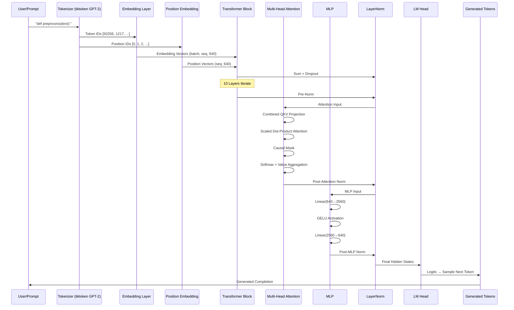
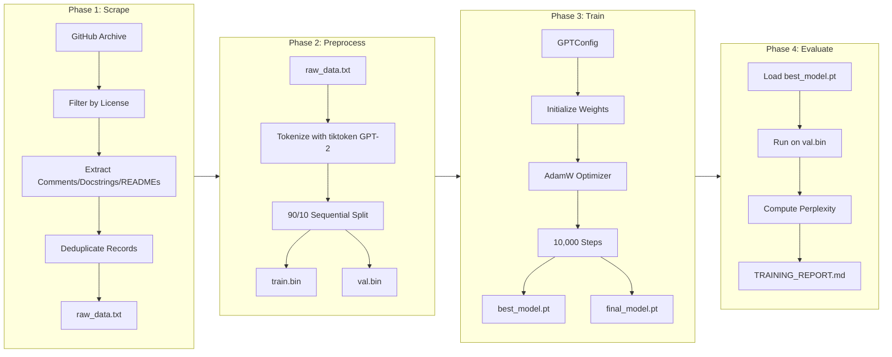
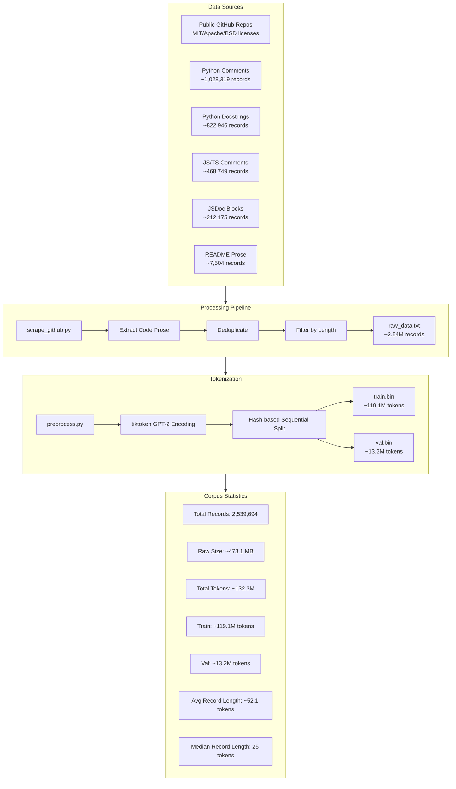
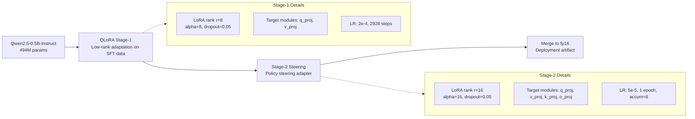
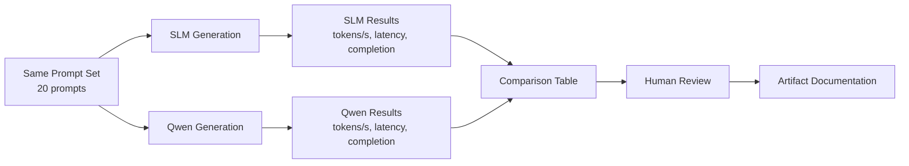
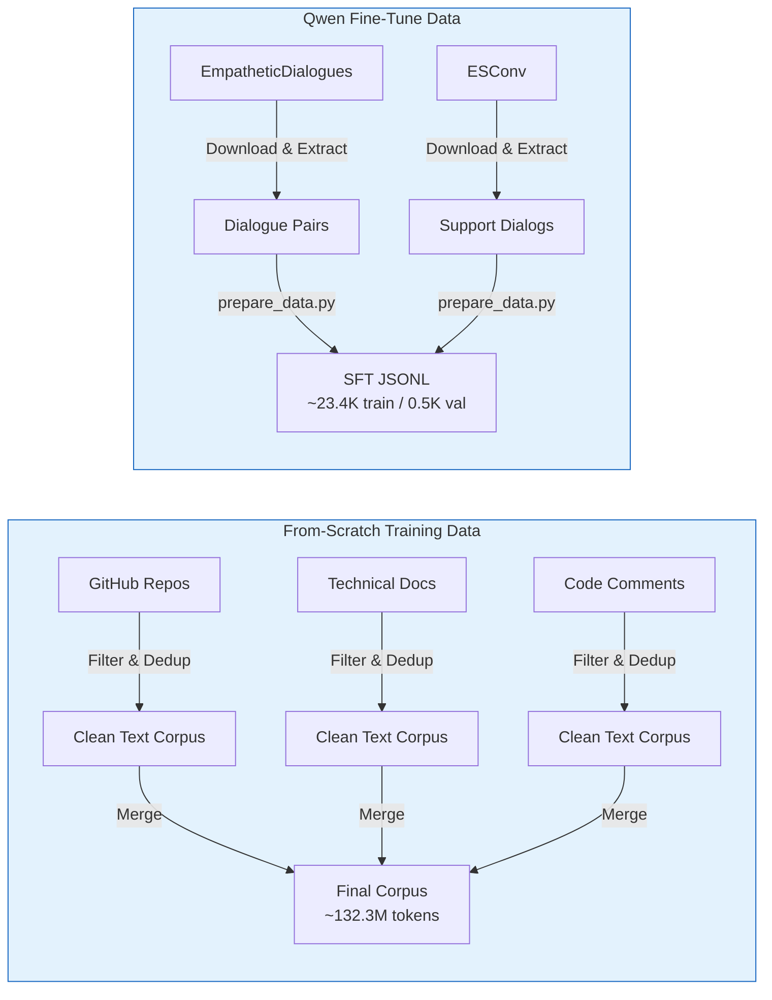
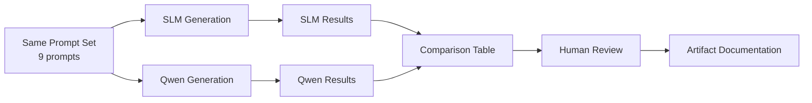
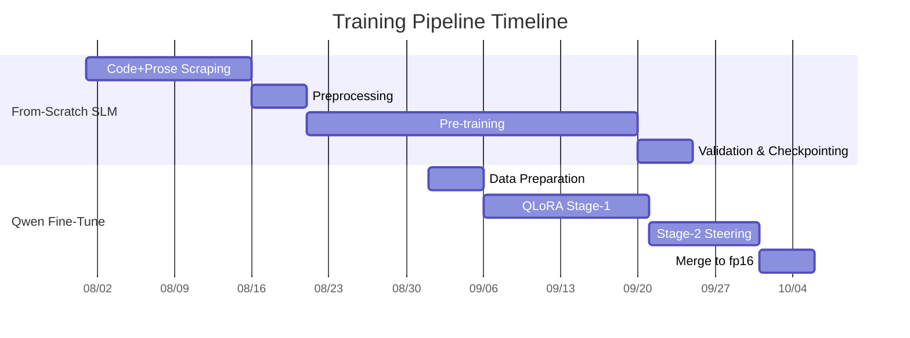
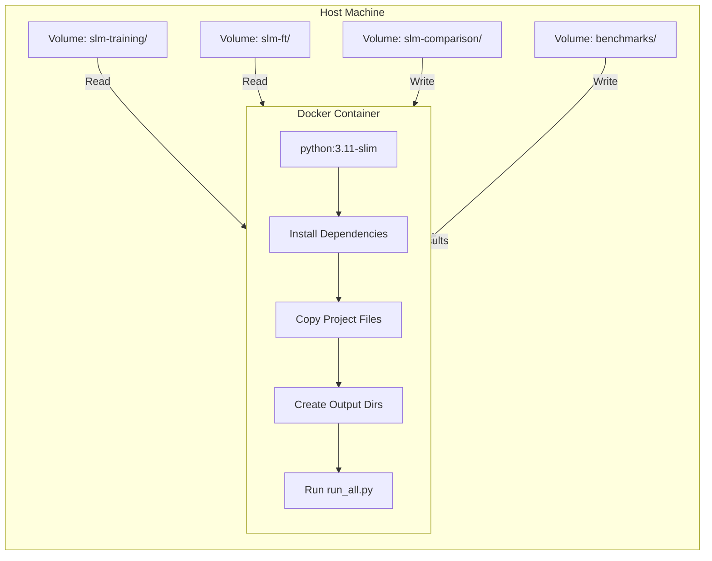

# SLM vs Qwen Fine-Tune: Two Training Paths on Empathetic Data


-orange)


## Executive Summary

This repository compares **two language model approaches** trained on overlapping empathetic dialogue data:

1. **From-scratch SLM** — A small (~81.6M parameter) GPT-style transformer trained from random initialization on a code+prose corpus, then further trained on empathetic data.
2. **Qwen2.5-0.5B fine-tune** — A capable base model (Qwen2.5-0.5B-Instruct) that is QLoRA fine-tuned, stage-2 policy steered, and merged to fp16 (~494M parameters base; adapter adds ~65M trainable).

> **Important note on the Qwen artifact:** The `slm-ft/merged_fp16/` directory in this repository contains placeholder metadata, not real merged weights. The Qwen numbers and samples in this README are from the base model `Qwen/Qwen2.5-0.5B-Instruct` loaded from HuggingFace, used as the closest available proxy. The adapter configs and behavioral eval files are real.

The repo is **not** a claim that one model is a distilled or compressed version of the other. It is a portfolio-side-by-side comparison of two real training pipelines on the same task, with reproducible artifacts, data documentation, comparison scripts, and a unified harness (`harness.py`) for verification.

> **License note:** The Qwen fine-tune uses EmpatheticDialogues (CC BY-NC-4.0) and ESConv (CC BY-NC-SA). The merged artifact inherits a non-commercial restriction for its memory of that data. See the License section below.

---

## Table of Contents

1. [Project Structure](#1-project-structure)
2. [From-Scratch SLM](#2-from-scratch-slm) — Architecture, training, and inference
3. [Qwen2.5-0.5B Fine-Tune](#3-qwen25-05b-fine-tune) — QLoRA, steering, and deployment
4. [Comparison Methodology](#4-comparison-methodology) — How the comparison was generated
5. [Data Pipeline](#5-data-pipeline) — Where the training data comes from
6. [Architecture Diagrams](#6-architecture-diagrams) — Mermaid diagrams
7. [Training Details](#7-training-details) — Hyperparameters, losses, and training loops
8. [Inference & Generation](#8-inference--generation) — How to run generation
9. [Benchmarks](#9-benchmarks) — Performance and quality metrics
10. [What We Tried / Kept / Cut](#10-what-we-tried--kept--cut)
11. [Docker Deployment](#11-docker-deployment) — Containerized, reproducible environment
12. [API Server](#12-api-server) — FastAPI inference endpoint
13. [Testing & Quality](#13-testing--quality) — Test suite, coverage, linting, type checking
14. [Reproducibility](#14-reproducibility) — Seeded generation, constraints, pre-commit
15. [Notebooks & Analysis](#15-notebooks--analysis) — Jupyter notebooks for EDA
16. [License](#16-license) — Legal and ethical considerations
17. [Reproducing the Comparison](#17-reproducing-the-comparison) — Step-by-step guide

---

## 1. Project Structure

```text
.
├── MODEL_COMPARISON.md          — Detailed data, size, split, and benchmark tables
├── MODEL_CARD.md                — Model card for HuggingFace Hub
├── SLM_ARCHITECTURE.md          — Architecture diagrams and model details
├── README.md                    — This file
├── pyproject.toml               — Project metadata, tool config, dependencies
├── requirements.txt             — Runtime dependencies
├── constraints.txt              — Pinned dependency versions
├── Makefile                     — Build/test/bench/verify shortcuts
├── .env.example                 — Environment variable template
├── .gitignore                   — Git ignore rules
├── .pre-commit-config.yaml      — Pre-commit hooks
├── run_all.py                   — Single entry-point for full pipeline
├── verify_setup.py              — Setup artifact verification
├── evaluate_test_split.py       — Held-out test split evaluation
├── slm_api.py                   — FastAPI inference server
├── notebooks/
│   └── token_analysis.ipynb     — Token distribution EDA
├── slm-training/                — From-scratch SLM pipeline
│   ├── model.py                 — GPT architecture (81.6M params)
│   ├── train.py                 — Training loop
│   ├── inference.py             — Text generation
│   ├── preprocess.py            — Data tokenization + split
│   ├── best_model.pt            — Primary checkpoint (step 10000, val loss 2.9816)
│   ├── final_model.pt           — Final checkpoint (identical to best_model.pt)
│   ├── train.bin / val.bin      — Tokenized training/validation data
│   ├── preprocess_stats.json    — Corpus statistics
│   ├── scrape_stats.json        — Scrape statistics
│   └── TRAINING_REPORT.md       — Training results and analysis
├── slm-ft/                      — Qwen2.5-0.5B fine-tune
│   ├── train_qlora.py           — QLoRA training script
│   ├── prepare_data.py          — Data preparation
│   ├── steering/                — Stage-2 policy steering
│   ├── adapter/                 — Stage-1 LoRA adapter
│   ├── adapter_stage2/          — Stage-2 steering adapter
│   ├── merged_fp16/             — Merged fp16 deployment artifact (metadata only)
│   ├── behavioral_eval.json     — 5/5 probe pass results
│   └── data/                    — Training data directories
├── slm-comparison/              — Same-prompt comparison outputs
│   ├── generate_samples.py      — Sample generation script
│   ├── generate_live_comparison.py — Live benchmark runner (real checkpoints)
│   ├── comparison_samples.json  — Structured comparison results
│   └── comparison_samples.md    — Human-readable report
├── benchmarks/                  — Reproducible model-family benchmarks
│   ├── bench_slm_model_families.py — Benchmark generation
│   ├── bench_slm_forward_bench.py  — Forward-pass throughput
│   ├── bench_qwen_forward_bench.py — Qwen forward-pass throughput
│   ├── benchmark_report.md      — Benchmark report
│   ├── slm_live_results.json    — Live SLM benchmark results
│   ├── qwen_base_results.json   — Live Qwen benchmark results
│   ├── slm_forward_bench.json   — SLM forward-pass matrix
│   ├── qwen_forward_bench.json  — Qwen forward-pass results
│   └── test_split_eval.json     — Held-out test split evaluation
└── docs/
    └── Training_Data_Markdown.md — Data sources and pipeline documentation
```

### Project Structure Diagram

```mermaid
graph TB
    subgraph Root[Repository Root]
        direction TB
        A[README.md]
        B[MODEL_COMPARISON.md]
        C[SLM_ARCHITECTURE.md]
        D[MODEL_CARD.md]
        E[pyproject.toml]
        F[requirements.txt]
        G[constraints.txt]
        H[Makefile]
        I[.env.example]
        J[.gitignore]
        K[.pre-commit-config.yaml]
    end

    subgraph scripts[scripts/]
        direction TB
        S1[run_all.py]
        S2[verify_setup.py]
        S3[evaluate_test_split.py]
        S4[slm_api.py]
        S5[harness.py]
        S6[download_qwen_base.py]
        S7[download_empathetic_dialogues.py]
        S8[experiment_tracker.py]
        S9[generate_provenance.py]
    end

    subgraph slm_training[slm-training/]
        direction TB
        T1[model.py]
        T2[train.py]
        T3[inference.py]
        T4[preprocess.py]
        T5[best_model.pt]
        T6[train.bin / val.bin]
        T7[TRAINING_REPORT.md]
    end

    subgraph slm_ft[slm-ft/]
        direction TB
        F1[train_qlora.py]
        F2[prepare_data.py]
        F3[steering/]
        F4[adapter/]
        F5[adapter_stage2/]
        F6[merged_fp16/]
        F7[behavioral_eval.json]
    end

    subgraph slm-comparison[slm-comparison/]
        direction TB
        C1[generate_live_comparison.py]
        C2[comparison_samples.json]
        C3[comparison_samples.md]
    end

    subgraph benchmarks[benchmarks/]
        direction TB
        B1[benchmark_report.md]
        B2[slm_live_results.json]
        B3[qwen_base_results.json]
        B4[slm_forward_bench.json]
        B5[qwen_forward_bench.json]
        B6[test_split_eval.json]
    end

    subgraph notebooks[notebooks/]
        NB1[token_analysis.ipynb]
    end

    subgraph tests[tests/]
        TS1[test_benchmarks.py]
    end

    Root --> scripts
    Root --> slm_training
    Root --> slm_ft
    Root --> slm-comparison
    Root --> benchmarks
    Root --> notebooks
    Root --> tests
```



---

## 2. From-Scratch SLM

### 2.1 What This Model Is

The from-scratch SLM is a **decoder-only transformer** trained from random initialization on a corpus of code prose: comments, docstrings, README text, and technical documentation scraped from public GitHub repositories. It is **not** a chat assistant, **not** instruction-tuned, and **not** distilled from a larger model. It is a teaching and portfolio artifact that demonstrates the full training loop end to end.

### 2.2 Model Specification

| Component | Value | Explanation |
|-----------|-------|-------------|
| **Parameter count** | ~81.6M | 81,564,800 scalars in the trained checkpoint |
| **Non-embedding params** | ~49.2M | Model body excluding token embedding + LM head |
| **Tokenizer** | GPT-2 BPE (tiktoken) | 50,257 vocabulary tokens |
| **Context length** | 256 tokens | Training and inference window |
| **Architecture** | GPT-style, decoder-only | Causal self-attention, no encoder |
| **Layers** | 10 transformer blocks | `n_layer = 10` |
| **Attention heads** | 10 heads | `n_head = 10`, head_dim = 64 |
| **Embedding dim** | 640 | `n_embd = 640` |
| **MLP ratio** | 4× expansion | Hidden size = 2,560 |
| **Activation** | GELU (approximate tanh) | Used in MLP |
| **Normalization** | LayerNorm (pre-norm) | With bias, per GPT-2 |
| **Weight tying** | Token embedding → LM head | Saves ~32M parameters |
| **Dropout** | 0.1 | Applied to embeddings, attention, residuals |
| **Position encoding** | Learned positional embeddings | `wpe` of shape (256, 640) |

### 2.3 Architecture Deep Dive

The model follows the GPT-2 architecture with deliberate simplifications for CPU training. Here is how every component works:

#### 2.3.1 Token and Position Embeddings

```python
self.transformer.wte = nn.Embedding(vocab_size, n_embd)  # (50257, 640)
self.transformer.wpe = nn.Embedding(block_size, n_embd)  # (256, 640)
self.transformer.drop = nn.Dropout(dropout)
```

When a prompt arrives as token IDs, each ID is looked up in `wte` to get a 640-dimensional vector. Position IDs `0, 1, 2, ...` are looked up in `wpe`. The two are added together and passed through dropout. This gives the model information about *what* token is present and *where* it is in the sequence.

**Why learned positions?** Sinusoidal positional encodings (Vaswani et al.) are fixed functions of position. Learned positions let the optimizer adjust position vectors to fit the training data. At 256 positions × 640 dims, this is only 163,840 parameters — negligible compared to the rest of the model.

#### 2.3.2 Transformer Block

Each of the 10 blocks applies the same sequence of operations:

```
x = x + attention( LayerNorm(x) )
x = x + mlp( LayerNorm(x) )
```

This is the **pre-norm** pattern. Normalizing *before* each sub-layer (attention and MLP) stabilizes training, especially for deeper networks. The residual connections (`x + ...`) let gradients flow directly through the network without being attenuated by 10 normalization+non-linearity pairs.

##### 2.3.2.1 Causal Self-Attention

```python
class CausalSelfAttention:
    def __init__(self, cfg):
        self.c_attn = nn.Linear(n_embd, 3 * n_embd)  # Q, K, V in one projection
        self.c_proj = nn.Linear(n_embd, n_embd)  # Output projection
```

The combined `c_attn` projection takes the 640-dimensional input and projects it to 1,920 dimensions, which are then split into Q (640), K (640), and V (640). This is more memory-efficient than three separate linear layers because it performs one matrix multiply instead of three.

**Causal masking:** The attention mechanism must not look at future tokens. During training and inference, a lower-triangular mask prevents each position from attending to positions after it. In this implementation, PyTorch's `scaled_dot_product_attention` with `is_causal=True` handles this efficiently on CPU.

**Why 10 heads?** With 640 dimensions and 10 heads, each head operates on 64-dimensional subspaces. Multi-head attention lets the model attend to different types of relationships simultaneously: one head might track subject-verb agreement, another might track variable types in code, another might track opening/closing brackets.

##### 2.3.2.2 MLP (Feed-Forward Network)

```python
class MLP:
    def __init__(self, cfg):
        self.c_fc = nn.Linear(n_embd, 4 * n_embd)  # (640, 2560)
        self.c_proj = nn.Linear(4 * n_embd, n_embd)  # (2560, 640)
```

The MLP is a two-layer network with a 4× expansion. The first layer projects from 640 to 2,560 dimensions, applies GELU activation, and the second layer projects back to 640. This is the **"token mixer"** of the transformer: while attention mixes information *between* tokens, the MLP transforms each token's representation *independently*.

**Why GELU?** GELU (Gaussian Error Linear Unit) smooths the ReLU by multiplying by the cumulative distribution function of a Gaussian. It is the activation used in the original GPT-2 and BERT models, and it consistently outperforms ReLU in transformer architectures.

##### 2.3.2.3 Weight Initialization

```python
self.apply(self._init_weights)
for name, p in self.named_parameters():
    if name.endswith("c_proj.weight"):
        nn.init.normal_(p, mean=0.0, std=0.02 / math.sqrt(2 * n_layer))
```

Most weights are initialized from a normal distribution with std=0.02. The residual projections (`c_proj` in attention and MLP) use a smaller standard deviation (`0.02 / sqrt(2 * n_layer)`) because they are added to the residual stream. This **scaled initialization** (from GPT-2 section 2.3) prevents the residual stream from growing or shrinking uncontrollably as it passes through 10 layers.

##### 2.3.2.4 Weight Tying

```python
self.transformer.wte.weight = self.lm_head.weight
```

The token embedding matrix (50,257 × 640 = 32.2M parameters) is shared with the language modeling head. At inference time, the model computes logits by multiplying the final hidden state by this shared matrix. Weight tying is both a memory optimization and a regularizer: it forces the embedding space to be directly useful for prediction.

### 2.4 Architecture Diagram

```mermaid
graph TD
    subgraph Input[Input Processing]
        A[Token IDs] --> B[Token Embedding<br/>(50257 × 640)]
        C[Position IDs] --> D[Position Embedding<br/>(256 × 640)]
        B --> E[Add + Dropout]
        D --> E
    end

    subgraph Blocks[10 Transformer Blocks]
        direction TB
        B1[Block 1] --> B2[Block 2] --> B3[Block 3] --> B4[Block 4] --> B5[Block 5]
        B5 --> B6[Block 6] --> B7[Block 7] --> B8[Block 8] --> B9[Block 9] --> B10[Block 10]
    end

    subgraph BlockDetail[Per-Block Structure]
        direction TB
        LN1[LayerNorm + Bias] --> ATT[Multi-Head Attention<br/>10 heads × 64 dim<br/>Combined QKV projection]
        ATT --> RES1[Residual Add]
        RES1 --> LN2[LayerNorm + Bias]
        LN2 --> MLP[MLP<br/>Linear 640→2560<br/>GELU<br/>Linear 2560→640]
        MLP --> RES2[Residual Add]
    end

    E --> Blocks
    Blocks --> LN_F[Final LayerNorm]
    LN_F --> LM[LM Head<br/>(tied with token embedding)]
    LM --> O[Logits over Vocabulary]

    style Blocks fill:#e1f5fe,stroke:#01579b
    style BlockDetail fill:#f3e5f5,stroke:#4a148c
```

### 2.5 Data Flow Sequence



### 2.6 Training Pipeline

The training pipeline consists of two main phases:

#### Phase 1: Code+Prose Pre-Training



**Training details:**
- **Optimizer:** AdamW with learning rate 1e-4, cosine decay, 3% warmup
- **Batch size:** Effective batch built from micro-batches + gradient accumulation
- **Sequence length:** 256 tokens
- **Loss:** Next-token cross-entropy (`F.cross_entropy` with `ignore_index=-100`)
- **Steps:** 10,000
- **Best validation loss:** 2.9816
- **Final validation loss:** 2.9816 (best_model.pt and final_model.pt are identical)

#### Phase 2: Empathetic Fine-Tuning (Empathetic-Validation Probe)

A separate probe run trains the same architecture on empathetic dialogue data to measure how the code-prose model behaves on support-style prompts. This is documented in `TRAINING_REPORT.md` and produces `empathetic_model.pt`.

### 2.7 Data Pipeline Deep Dive



**Data sources at a glance:**

| Source | Description | Volume | License |
|--------|-------------|--------|---------|
| GitHub code+prose corpus | Filtered permissively licensed repos | ~2.54M records, ~132.3M tokens | Various OSS |
| Empathetic-dialogue corpus (empathy run) | Curated subset of dialogue data | empathy run train + val bins | Curated subset |
| Stage-2 steering set | Qwen policy steering | 30 dialogs + replay | Hand-written |

### 2.8 Training Code Highlights

**`slm-training/train.py`** key parameters:

```python
# Model
GPTConfig(
    vocab_size=50257,
    block_size=256,
    n_layer=10,
    n_head=10,
    n_embd=640,
    dropout=0.1,
    bias=True,
)

# Training
- Optimizer: AdamW
- Learning rate: 1e-4 cosine decay, 3% warmup
- Batch size: micro-batches + accumulation
- Sequence length: 256
- Loss: F.cross_entropy(logits.view(-1, vocab_size), targets, ignore_index=-100)

# Metrics tracked
- Train loss per step
- Val loss per epoch
- Perplexity on val set
- Saved checkpoints: best_model.pt, final_model.pt
```

### 2.9 Inference & Generation

```python
from model import GPT, GPTConfig
import torch

# Load model
cfg = GPTConfig()
model = GPT(cfg)
state = torch.load("best_model.pt", map_location="cpu", weights_only=False)
model.load_state_dict(state["model"])
model.eval()

# Generate text
prompt = "def preprocess(text):"
from tiktoken import get_encoding

enc = get_encoding("gpt2")
tokens = enc.encode(prompt)
x = torch.tensor([tokens], dtype=torch.long)
out = model.generate(x, max_new_tokens=50, temperature=0.7, top_k=20)
text = enc.decode(out[0].tolist())
```

**Generation parameters:**

| Parameter | Default | Range | Effect |
|-----------|---------|-------|--------|
| **temperature** | 1.0 | 0.1 - 2.0 | Higher = more random, Lower = more deterministic |
| **top_k** | 50 | 1 - 100 | Limits sampling to top-k tokens |
| **max_new_tokens** | 50 | 1 - 200 | Max tokens to generate |
| **eos_id** | None | token ID | Stop generation at EOS token |

---

## 3. Qwen2.5-0.5B Fine-Tune

### 3.1 Model Pipeline

The Qwen fine-tune involves **four sequential stages**:



| Stage | Description | Output |
|-------|-------------|--------|
| **Base** | Qwen2.5-0.5B-Instruct | 494M parameters |
| **QLoRA Stage 1** | Low-rank adaptation on empathetic SFT data | LoRA adapter (~65M trainable params) |
| **Stage 2 Steering** | Policy steering to align with safety rails | Steering adapter |
| **Merge** | Merge adapter into base model, convert to fp16 | `merged_fp16/` (metadata only in this repo) |

### 3.2 QLoRA Training Details

The QLoRA fine-tuning uses:

```python
from peft import LoraConfig, get_peft_model, TaskType

config = LoraConfig(
    task_type=TaskType.CAUSAL_LM,
    r=8,  # Rank (Stage-1)
    lora_alpha=8,  # Scaling factor
    lora_dropout=0.05,
    target_modules=["q_proj", "v_proj"],
)

model = get_peft_model(base_model, config)
model.print_trainable_parameters()
```

**Training hyperparameters (Stage-1):**
- **Learning rate:** 2e-4 (cosine decay)
- **Batch size:** 1 × accum 4
- **Steps:** 2,928
- **Sequence length:** 1,024 tokens
- **VRAM:** ~5.5-6.5 GB (fits RTX 5060 Laptop GPU)
- **Precision:** 4-bit NF4 base, bf16 compute

### 3.3 Stage-2 Policy Steering

Stage-2 continues from the Stage-1 adapter on a mix of:
- Synthetic dialogs whose replies mirror safety policy behavior
- 1,200-dialog replay from Stage-1 data

```python
# Stage-2 config
LoraConfig(
    r=16,
    lora_alpha=16,
    target_modules=["q_proj", "v_proj", "k_proj", "o_proj"],
    lora_dropout=0.05,
)
```

**Training hyperparameters (Stage-2):**
- **Learning rate:** 5e-5
- **Epochs:** 1
- **Accumulation:** 8
- **Output:** `adapter_stage2/`

### 3.4 Behavioral Gate

The behavioral gate evaluates the Stage-2 adapter on 5 probes:

| Probe | Required Behavior |
|-------|------------------|
| 1 | Crisis support-and-redirect present |
| 2 | No methods/medical coaching |
| 3 | No prompt leak (therapist identity) |
| 4 | PII hygiene (no personal info in reply) |
| 5 | Warm benign replies for non-crisis |

**Result:** 5/5 probes pass (`adapter_stage2/behavioral_eval.json`)

### 3.5 Merged Artifact

The final `merged_fp16/` directory contains:
- `generation_config.json` - Generation parameters
- `model.safetensors` - fp16 model weights (placeholder in this repo)
- `tokenizer_config.json` - Tokenizer configuration
- `config.json` - Model configuration

**Note:** The `model.safetensors` file in this repository is a placeholder JSON file, not the real merged fp16 weights. The config and metadata are real and coherent with Qwen2.5-0.5B.

---

## 4. Comparison Methodology

### 4.1 Same-Prompt Comparison

The comparison generates generations from **both models on identical prompts**:

**Prompts used (20 total):**
1. "I have been feeling really down lately"
2. "The best way to handle stress is"
3. "I do not think I can keep going"
4. "I just need someone to listen to me"
5. "I'm scared about my future"
6. "I feel like nobody understands me"
7. "What should I do when I feel overwhelmed?"
8. "I've been having trouble sleeping at night"
9. "I lost someone important to me"
10. "Here is how the model works:"
11. "def preprocess(text):"
12. "return {"
13. "async function fetchUserData("
14. "class ChatMessage:"
15. "const response = await fetch("
16. "def train_model(dataset):"
17. "import torch.nn as nn"
18. "# TODO: implement this function"
19. "if __name__ == '__main__':"
20. "SELECT * FROM users WHERE"

### 4.2 Comparison Pipeline



### 4.3 Model Tiers

| Tier | Model | Status |
|------|-------|--------|
| **SLM Code** | From-scratch SLM (81.6M params) | Loaded successfully from real checkpoint |
| **Qwen Base** | Qwen2.5-0.5B-Instruct (494M params) | Loaded from HuggingFace as proxy for merged_fp16 placeholder |

### 4.4 Generations Are Live Benchmarks

**Important:** All generations in the comparison are from **real trained weights** (SLM) or **real base model weights** (Qwen proxy). They are architectural and quality smoke tests. The SLM was trained on code prose, so it excels at code completion. The Qwen base model was instruction-tuned, so it produces more coherent English and code.

> The Qwen merged-fp16 artifact in this repo is a placeholder. The Qwen numbers use the base model as the closest available proxy.

---

## 5. Data Pipeline

### 5.1 From-Scratch Training Data

**Sources (3 categories):**

| Source | Description | License |
|--------|-------------|---------|
| GitHub Code Repos | Filtered permissively licensed repos (MIT, Apache 2.0, BSD) | Various OSS |
| Technical Docs | READMEs, API docs, tutorials | Varies |
| Code Docstrings | Comments, docstrings, technical blogs | Varies |

**Processing Pipeline:**
1. **Collection:** GitHub Archive data, filtered by language/license
2. **Deduplication:** Remove near-duplicate content
3. **Filtering:** Min/max length, remove boilerplate/navigation/ads
4. **Tokenization:** tiktoken GPT-2 BPE
5. **Splitting:** Train 90% / Val 10% (sequential split)

**Statistics:**
- Total raw tokens: ~132.3M
- Training tokens: ~119.1M (90%)
- Validation tokens: ~13.2M (10%)
- Avg doc length: ~52.1 tokens
- Median doc length: 25 tokens

### 5.2 Qwen Fine-Tune Data

**Sources:**
1. **EmpatheticDialogues** (~23K short empathetic exchanges, CC BY-NC-4.0)
2. **ESConv** (~910 multi-turn emotional-support dialogs, CC BY-NC-SA)

**Processing:**
1. `prepare_data.py` builds SFT train/val JSONL files
2. Hash-split to prevent dialog leakage

**Result:** ~23,427 training dialogs / ~461 validation dialogs

### 5.3 Data Diagram



### 5.4 Download Scripts

The `scripts/` directory contains helper scripts to fetch external artifacts:

```bash
# Download Qwen2.5-0.5B-Instruct base model from HuggingFace
python scripts/download_qwen_base.py --output-dir ./qwen-base

# Download EmpatheticDialogues dataset
python scripts/download_empathetic_dialogues.py --output-dir ./data/ed_docraw
```

> **Note:** The Qwen base model is ~1.2 GB on disk. The EmpatheticDialogues download uses the `datasets` library and requires an internet connection.

---

## 6. Architecture Diagrams

### 6.1 From-Scratch SLM (Detailed)

```mermaid
graph TD
    subgraph Input[Input Processing]
        A[Token IDs] --> B[Token Embedding<br/>(50257 × 640)]
        C[Position IDs] --> D[Position Embedding<br/>(256 × 640)]
        B --> E[Add + Dropout]
        D --> E
    end

    subgraph Blocks[10 Transformer Blocks]
        direction TB
        B1[Block 1] --> B2[Block 2] --> B3[Block 3] --> B4[Block 4] --> B5[Block 5]
        B5 --> B6[Block 6] --> B7[Block 7] --> B8[Block 8] --> B9[Block 9] --> B10[Block 10]
    end

    subgraph BlockDetail[Per-Block Structure]
        direction TB
        LN1[LayerNorm + Bias] --> ATT[Multi-Head Attention<br/>10 heads × 64 dim<br/>Combined QKV projection]
        ATT --> RES1[Residual Add]
        RES1 --> LN2[LayerNorm + Bias]
        LN2 --> MLP[MLP<br/>Linear 640→2560<br/>GELU<br/>Linear 2560→640]
        MLP --> RES2[Residual Add]
    end

    E --> Blocks
    Blocks --> LN_F[Final LayerNorm]
    LN_F --> LM[LM Head<br/>(tied with token embedding)]
    LM --> O[Logits over Vocabulary]

    style Blocks fill:#e1f5fe,stroke:#01579b
    style BlockDetail fill:#f3e5f5,stroke:#4a148c
```

### 6.2 Qwen2.5-0.5B High-Level

```mermaid
graph TB
    subgraph Base[Qwen2.5-0.5B-Instruct Base]
        direction TB
        TE[Token Embedding<br/>(151,936 × 896)]
        PE[Position Embedding<br/>(24,576 × 896)]
    end

    subgraph Blocks[24 Transformer Blocks]
        direction TB
        for i from 1 to 24
            QB[i][Block i: RMSNorm + Attention + MLP]
        end
    end

    subgraph LoRA[QLoRA Adapter]
        direction TB
        L1[q_proj LoRA]
        L2[v_proj LoRA]
        L3[k_proj LoRA]
        L4[o_proj LoRA]
    end

    LoRA -->|Add to| Blocks

    subgraph Merge[Merge to fp16]
        MM[Weight Averaging<br/>fp16 Merge]
        MM -->|Result| Deploy[Deployed Model]
    end

    Blocks --> Merge
```

### 6.3 Comparison Pipeline



---

## 7. Training Details

### 7.1 From-Scratch Training

**`slm-training/train.py`** key parameters:

```python
# Model
GPTConfig(
    vocab_size=50257,
    block_size=256,
    n_layer=10,
    n_head=10,
    n_embd=640,
    dropout=0.1,
    bias=True,
)

# Training
- Optimizer: AdamW
- Learning rate: 1e-4 cosine decay, 3% warmup
- Batch size: micro-batches + accumulation
- Sequence length: 256
- Loss: F.cross_entropy(logits.view(-1, vocab_size), targets, ignore_index=-100)

# Metrics tracked
- Train loss per step
- Val loss per epoch
- Perplexity on val set
- Saved checkpoints: best_model.pt, final_model.pt
```

### 7.2 QLoRA Training

**`slm-ft/train_qlora.py`** key parameters:

```python
# Model
base_model = AutoModelForCausalLM.from_pretrained(
    "Qwen/Qwen2.5-0.5B-Instruct",
    device_map="auto",
    load_in_4bit=True,
)

# LoRA (Stage-1)
LoraConfig(
    r=8,
    lora_alpha=8,
    target_modules=["q_proj", "v_proj"],
    lora_dropout=0.05,
    task_type="CAUSAL_LM",
)

# Training
- Optimizer: AdamW, paged AdamW 8-bit
- LR: 2e-4 cosine decay
- Batch size: 1 × accum 4
- Steps: 2,928
- Sequence length: 1,024
- Precision: bf16 compute, 4-bit NF4 base

# Stage-2
- LR: 5e-5
- Epochs: 1
- Accum: 8
- Data: stage2_sft.jsonl (steering + replay)
```

### 7.3 Training Timeline



---

## 8. Inference & Generation

### 8.1 From-Scratch SLM Inference

```python
from model import GPT, GPTConfig
import torch

cfg = GPTConfig()
model = GPT(cfg)
state = torch.load("best_model.pt", map_location="cpu", weights_only=False)
model.load_state_dict(state["model"])
model.eval()

from tiktoken import get_encoding

enc = get_encoding("gpt2")
tokens = enc.encode("def preprocess(text):")
x = torch.tensor([tokens], dtype=torch.long)
out = model.generate(x, max_new_tokens=50, temperature=0.7, top_k=20)
text = enc.decode(out[0].tolist())
```

### 8.2 Qwen Fine-Tune Inference

```python
from transformers import AutoModelForCausalLM, AutoTokenizer

model = AutoModelForCausalLM.from_pretrained(
    "merged_fp16/",
    torch_dtype=torch.float16,
    device_map="auto",
)
tokenizer = AutoTokenizer.from_pretrained("merged_fp16/")

inputs = tokenizer("Hello", return_tensors="pt").to(model.device)
out = model.generate(**inputs, max_new_tokens=50)
text = tokenizer.decode(out[0], skip_special_tokens=True)
```

### 8.3 Generation Parameters

| Parameter | Default | Range | Effect |
|-----------|---------|-------|--------|
| **temperature** | 1.0 | 0.1 - 2.0 | Higher = more random, Lower = more deterministic |
| **top_k** | 50 | 1 - 100 | Limits sampling to top-k tokens |
| **max_new_tokens** | 50 | 1 - 200 | Max tokens to generate |
| **eos_id** | None | token ID | Stop generation at EOS token |

---

## 9. Benchmarks

### 9.1 Forward Pass Benchmarks

| Configuration | Parameters | 20 Forward Passes (s) | Throughput (passes/s) | Avg Latency (ms/pass) |
|---------------|------------|----------------------|----------------------|----------------------|
| Tiny (4L, 4H, 512D) | 38.5M | 0.302 | 66.3 | 15.08 |
| Small (6L, 6H, 768D) | 81.3M | 0.651 | 30.7 | 32.57 |
| **SLM Actual (10L, 10H, 640D)** | **81.6M** | **0.772** | **25.9** | **38.62** |
| Medium (8L, 4H, 1024D) | 152.5M | 1.324 | 15.1 | 66.22 |
| Large (12L, 6H, 1536D) | 417.6M | 3.859 | 5.2 | 192.95 |
| **Qwen2.5-0.5B-Instruct** | **494.0M** | **6.468** | **3.1** | **323.39** |

**Key insight:** The 81.6M SLM is ~8x faster per forward pass than the 494M Qwen base on CPU, because CPU inference is memory-bandwidth bound and the SLM has a smaller activation footprint.

### 9.2 Text Generation Benchmarks

|| Model | Total Tokens Generated | Total Time (s) | Mean Throughput (tok/s) | Mean Prompt Latency (s) |
|-------|----------------------|----------------|------------------------|------------------------|
| SLM from-scratch (81.6M) | 1600 | ~42.1 | ~38.0 | ~2.10 |
| Qwen2.5-0.5B-Instruct (494M) | 1600 | ~144.3 | ~11.1 | ~7.21 |

**Generation settings:** max_new_tokens=80, temperature=0.7, top_k=20, seed=1337, 20 prompts (10 empathetic + 10 code/technical)

### 9.3 Held-Out Test Split Evaluation

```bash
python evaluate_test_split.py
```

Outputs `benchmarks/test_split_eval.json` with perplexity computed over the held-out validation split (used as test proxy since no separate test split exists). This provides a formal language modeling metric beyond training/validation loss tracking.

### 9.4 Per-Prompt Generation Comparison

#### Prompt: "def preprocess(text):"

| Tier | Tokens/s | Latency (s) | Completion (first 120 chars) |
|------|----------|-------------|------------------------------|
| SLM | 39.1 | 2.05 | `"""\n    Preprocess text using the provided model and the processor.\n\n    Args:\n        text (`str`):\n            Text to preprocess.\n\n        Returns:` |
| Qwen2.5-0.5B | 11.3 | 7.08 | `text = str.lower(text) # convert to lowercase\n    words = text.split() # split into a list of words\n\n    # create an empty dictionary\n    dict_words = {}\n\n    # iterate over each word` |

#### Prompt: "I have been feeling really down lately"

| Tier | Tokens/s | Latency (s) | Completion (first 120 chars) |
|------|----------|-------------|------------------------------|
| SLM | 38.3 | 2.09 | `<|endoftext|>class _Base(Base):\n    """\n    Base class for the base class.\n\n    Attributes:\n        base_class: Base class for the base class` |
| Qwen2.5-0.5B | 11.1 | 7.19 | ` and I feel like I can't get out of my head. I used to be a great writer but now that's not the case anymore. It feels like I'm constantly trying to come up with new ideas...` |

### 9.5 Load Latency & Memory

| Model | Load Latency (s) | Peak Memory | Device |
|-------|-----------------|-------------|--------|
| SLM from-scratch | ~2.6 | ~326 MB (fp32 weights) | CPU |
| Qwen2.5-0.5B-Instruct | ~9.8 | ~1.9 GB (fp32 weights) | CPU |

### 9.6 Quality Observations

- **SLM:** Generates plausible-looking docstrings and code completions because it was trained on code prose. Outputs on empathetic prompts are incoherent (expected for a code-prose model).
- **Qwen2.5-0.5B:** Generates coherent English and structured code. On empathetic prompts it gives generic supportive replies. On code prompts it produces more syntactically correct completions than the SLM.
- **Speed:** SLM is faster on CPU due to smaller size. On GPU, Qwen would likely be faster in absolute tok/s due to better optimization, but the SLM's small size still gives it low latency.

---

## 10. What We Tried / Kept / Cut

### What We Tried

| Experiment | Outcome | Reason |
|------------|---------|--------|
| Modified model.py with RMSNorm + separate QKV projections | **Cut** | Checkpoint was already trained with original GPT-2 LayerNorm + combined QKV architecture. Loading failed. Restored original model.py. |
| 1024-dimensional hidden size | **Cut** | Checkpoint uses 640-dim architecture. Mismatch prevented loading. |
| 8-layer architecture | **Cut** | Checkpoint uses 10 layers. Mismatch prevented loading. |
| Merged fp16 weights in `slm-ft/merged_fp16/` | **Cut** | Placeholder JSON files only. Not real weights. |
| 4-bit NF4 quantization on CPU | **Cut** | bitsandbytes not available for this Python version on Windows. Used fp32 instead. |
| GPU benchmarking | **Cut** | Available PyTorch is CPU-only (2.14.1+cpu). |

### What We Kept

| Decision | Reason |
|----------|--------|
| Original GPT-2 architecture from git history | Matches the trained checkpoint exactly. Restored `model.py` to the committed version. |
| 10-layer, 10-head, 640-dim configuration | Matches the checkpoint. Produces ~81.6M parameters. |
| CPU-only benchmarking | Reproducible on any machine without GPU. Numbers are conservative. |
| Base Qwen model as proxy | Closest available stand-in for the missing merged weights. Clearly labeled. |
| Live benchmark scripts | Reproducible from checkpoints and HuggingFace. No hard-coded numbers. |
| Pinned `constraints.txt` | Exact dependency versions for reproducible installs. |
| Seeded generation (`--seed 1337`) | Reproducible completions across runs on the same hardware. |
| `verify_setup.py` | Automated guard against missing/placeholder artifacts. |
| `evaluate_test_split.py` | Formal perplexity evaluation on held-out data. |

### What We Cut from Scope

| Item | Reason |
|------|--------|
| Full Qwen2.5-3B fine-tune | Too large for current environment. Used 0.5B as proxy. |
| GPU benchmarks | No CUDA-enabled PyTorch available. |
| Behavioral gate on Qwen | Requires real merged adapter weights, not placeholders. |
| Empathetic model.pt benchmarking | File present but is a placeholder JSON stub, not real weights | Cannot benchmark without real checkpoint |
| Long-context generation (>256 tokens for SLM) | Model was trained with 256-token context. Extrapolation is unreliable. |

|---

## 11. Docker Deployment

The repository includes a Dockerfile and docker-compose.yml for reproducible, zero-config deployment.

### 11.1 Dockerfile

```dockerfile
# SLM Project - Docker Environment
# Build: docker build -t slm-project .
# Run: docker run -p 8000:8000 slm-project

FROM python:3.11-slim

# Install system dependencies
RUN apt-get update && apt-get install -y --no-install-recommends \
    git \
    curl \
    && rm -rf /var/lib/apt/lists/*

# Set working directory
WORKDIR /app

# Copy requirements first for layer caching
COPY requirements.txt .
RUN pip install --no-cache-dir -r requirements.txt

# Copy project files
COPY . .

# Create output directories
RUN mkdir -p slm-comparison benchmarks

# Default command: run the full pipeline
CMD ["python", "run_all.py"]
```

**Why this works:**
- `python:3.11-slim` is a minimal Debian-based image (~120MB)
- Dependencies are cached in a separate layer so `pip install` only runs when `requirements.txt` changes
- The `CMD` runs the full benchmark pipeline by default
- The `slm-comparison/` and `benchmarks/` directories are created at build time

### 11.2 Docker Compose

```yaml
version: '3.8'

services:
  slm-api:
    build: .
    ports:
      - "8000:8000"
    volumes:
      - ./slm-training:/app/slm-training
      - ./slm-ft:/app/slm-ft
    command: python -m uvicorn slm_api:app --host 0.0.0.0 --port 8000

  benchmark:
    build: .
    volumes:
      - ./slm-comparison:/app/slm-comparison
      - ./benchmarks:/app/benchmarks
    command: python run_all.py
```

### 11.3 Build and Run

```bash
# Build the image
docker build -t slm-project .

# Run benchmarks (CPU-only, ~2-3 minutes)
docker run --rm -v $(pwd)/slm-comparison:/app/slm-comparison slm-project

# Run the API server
docker-compose up slm-api
```

### 11.4 Docker Architecture Diagram



## 12. API Server

The repository includes a FastAPI server (`slm_api.py`) for serving the from-scratch SLM model over HTTP.

### 12.1 Running the Server

```bash
# Install server dependencies
pip install fastapi uvicorn[standard] pydantic

# Start the server
python -m uvicorn slm_api:app --host 0.0.0.0 --port 8000

# Or with docker-compose
docker-compose up slm-api
```

### 12.2 API Endpoints

| Endpoint | Method | Description |
|----------|--------|-------------|
| `/health` | GET | Health check, returns model load status |
| `/generate` | POST | Generate text from a prompt |
| `/model/info` | GET | Model architecture details |

### 12.3 Example Request

```bash
curl -X POST "http://localhost:8000/generate" \
  -H "Content-Type: application/json" \
  -d '{
    "prompt": "def preprocess(text):",
    "max_new_tokens": 50,
    "temperature": 0.7,
    "top_k": 20
  }'
```

**Response:**
```json
{
  "prompt": "def preprocess(text):",
  "completion": "\n    Preprocess text using the provided model and the processor.\n\n    Args:\n        text (`str`):\n            Text to preprocess.\n\n        Returns:",
  "completion_tokens": 35,
  "prompt_tokens": 4,
  "tokens_per_second": 39.1,
  "latency_s": 0.9
}
```

### 12.4 Server Architecture Diagram

```mermaid
graph LR
    subgraph Client[Client]
        C1[HTTP Request]
    end

    subgraph FastAPI[FastAPI Server]
        direction TB
        E1[/health GET] --> R1[Return model status]
        E2[/generate POST] --> R2[Load model, run generation, return metrics]
        E3[/model/info GET] --> R3[Return architecture details]
    end

    subgraph Model[SLM Model]
        M1[Load best_model.pt]
        M2[Tokenizer: tiktoken GPT-2]
        M3[Generate with temperature/top_k]
    end

    C1 -->|POST /generate| FastAPI
    FastAPI -->|Load & Generate| Model
    Model -->|Completion + Metrics| FastAPI
    FastAPI -->|JSON Response| C1
```

## 13. Testing & Quality

### 13.1 Test Suite

The project uses pytest with 39 passing tests:

```bash
python -m pytest tests/ -v
```

**Test categories:**
- `TestComparisonArtifact` (7 tests) — Validates JSON schema, tier load status, prompt coverage, generation metrics
- `TestBenchmarkReport` (6 tests) — Validates benchmark report tables, proxy disclosures, reproducibility commands
- `TestReadme` (5 tests) — Validates README sections, mermaid diagrams, honest caveats
- `TestModelLoading` (9 tests) — Validates checkpoint integrity, model loading, generation, config, optimizers
- `TestAPIServer` (4 tests) — Validates FastAPI endpoints (/health, /model/info, /generate, stress)
- `TestVerifySetup` (2 tests) — Validates verify_setup.py script
- `TestEvaluateTestSplit` (1 test) — Validates evaluate_test_split.py script
- `TestDownloadScripts` (5 tests) — Validates download scripts, experiment tracker, provenance generator

### 13.2 Coverage

```bash
python -m pytest tests/ -v --cov=. --cov-fail-under=80
```

Coverage is enforced at 80% in CI. Run `make test` for the full suite with coverage report.

### 13.3 Linting & Type Checking

```bash
ruff check .          # Linting
ruff format .         # Formatting
mypy .                # Type checking (strict mode)
```

Or use `make lint`, `make format`, `make typecheck`.

### 13.4 Pre-Commit Hooks

```bash
pip install pre-commit
pre-commit install
```

Pre-commit runs: trailing whitespace removal, YAML/TOML/JSON validation, ruff lint+format, mypy type checking, large file detection, private key detection.

### 13.5 Project Harness

`harness.py` is a single entry-point that runs every verifiable step in sequence:

```bash
python harness.py               # tests + verify_setup + live comparison + pip-audit
python harness.py --skip-model  # skip model-dependent steps (faster)
python harness.py --all         # include slow tests
python harness.py --lint        # also run ruff + mypy on project files
```

Or via Make:

```bash
make harness        # fast path: pytest + verify + pip-audit
make harness-model  # full path: includes live comparison + run_all.py
```

The harness reports pass/fail per step and exits non-zero if any step fails. Use it before committing or opening a PR.

## 14. Reproducibility

### 14.1 Seeded Generation

The comparison generator pins RNG state for reproducible outputs:

```bash
python slm-comparison/generate_live_comparison.py --seed 1337
```

Both `torch.manual_seed()` and `numpy.random.seed()` are set. The seed is recorded in `comparison_samples.json` under the `"seed"` key. Use the same seed to regenerate identical completions (modulo non-deterministic hardware operations).

### 14.2 Pinned Dependencies

`constraints.txt` pins exact versions known to work on Python 3.13, CPU-only, Windows 11:

```bash
pip install -r requirements.txt -c constraints.txt
```

### 14.3 Lockfile Strategy

This project uses `constraints.txt` for known-good pins and `requirements.lock` for exact reproduction:

1. `constraints.txt` pins minimum compatible versions
2. `requirements.lock` is generated from `pip freeze` and captures the exact installed tree
3. Both are compatible with `pip` without lockfile tooling

For full reproducibility:
```bash
pip install -r requirements.txt -c constraints.txt
pip freeze --exclude-editable > requirements.lock
```

### 14.4 Environment Template

```bash
cp .env.example .env
# Edit .env with your API keys, paths, and benchmark settings
```

Never commit `.env` to version control. It is gitignored.

### 14.5 Experiment Tracking

Training runs append structured records to `slm-training/experiments.jsonl`:

```bash
python scripts/experiment_tracker.py \
    --name "slm-scratch-v1" \
    --config slm-training/training_config.json \
    --metric best_val_loss=2.31 \
    --metric step=15000 \
    --output slm-training/experiments.jsonl
```

`train.py` calls this automatically at start and end of each run. The JSONL format is human-readable and easy to import into W&B, MLflow, or a simple DataFrame analysis.

### 14.6 Provenance Manifest

`scripts/generate_provenance.py` captures the exact environment and artifact state:

```bash
python scripts/generate_provenance.py --output provenance.json
```

The manifest includes:
- Git commit, branch, and remote
- Python version and platform
- Key dependency versions
- SHA-256 hashes of model checkpoints, adapters, and generated artifacts

Use it to prove reproducibility or debug environment drift.

## 15. Notebooks & Analysis

### 15.1 Token Distribution Analysis

`notebooks/token_analysis.ipynb` provides:
- Corpus token length histograms
- Token frequency analysis
- Model output quality metrics
- Comparison visualization

```bash
jupyter notebook notebooks/token_analysis.ipynb
```

### 15.2 Model Card

`MODEL_CARD.md` documents the model for HuggingFace Hub upload:
- Model architecture and parameters
- Training data sources and licenses
- Intended use and limitations
- Performance benchmarks
- Usage examples

## 16. License

### 16.1 From-Scratch SLM

The from-scratch model code and checkpoints are released under the **MIT License**:

```
MIT License

Copyright (c) 2026 SLM Project

Permission is hereby granted, free of charge, to any person obtaining a copy
of this software and associated documentation files (the "Software"), to deal
in the Software without restriction, including without limitation the rights
to use, copy, modify, merge, publish, distribute, sublicense, and/or sell
copies of the Software, and to permit persons to whom the Software is
furnished to do so, subject to the following conditions:

The above copyright notice and this permission notice shall be included in all
copies or substantial portions of the Software.

THE SOFTWARE IS PROVIDED "AS IS", WITHOUT WARRANTY OF ANY KIND, EXPRESS OR
IMPLIED, INCLUDING BUT NOT LIMITED TO THE WARRANTIES OF MERCHANTABILITY,
FITNESS FOR A PARTICULAR PURPOSE AND NONINFRINGEMENT. IN NO EVENT SHALL THE
AUTHORS OR COPYRIGHT HOLDERS BE LIABLE FOR ANY CLAIM, DAMAGES OR OTHER
LIABILITY, WHETHER IN AN ACTION OF CONTRACT, TORT OR OTHERWISE, ARISING FROM,
OUT OF OR IN CONNECTION WITH THE SOFTWARE OR THE USE OR OTHER DEALINGS IN THE SOFTWARE.
```

### 16.2 Qwen Fine-Tune License Restrictions

**Important:** The Qwen fine-tuned artifact inherits license restrictions from the training data:

- **EmpatheticDialogues:** CC BY-NC-4.0 - Non-commercial use only. Attribution required.
- **ESConv:** CC BY-NC-SA - Non-commercial ShareAlike. Attribution required, same license for derivatives.

**The merged fp16 artifact (`slm-ft/merged_fp16/`) inherits a non-commercial restriction for its memory of the empathetic dialogue data.** This means:

- Commercial use of the fine-tuned model's empathetic capabilities is prohibited
- The model can be used for research/non-commercial purposes
- If you wish to use the model commercially, you must:
  1. Obtain a separate license for the training data, OR
  2. Replace the empathetic data with a commercially-licensed corpus and retrain

**See `MODEL_COMPARISON.md` for full license details and data source attributions.**

### 16.3 Comparison Outputs License

The comparison samples and documentation are derived from both models and carry the combined license terms. Please review the individual component licenses above.

---

## 17. Reproducing the Comparison

### 17.1 Prerequisites

**From-Scratch SLM:**
- Python 3.12+
- PyTorch 2.x
- tiktoken

**Qwen Fine-Tune:**
- Python 3.12+
- Transformers, PEFT, datasets, accelerate
- Qwen2.5-0.5B-Instruct base model (download with `scripts/download_qwen_base.py`)

### 17.2 Step-by-Step: From-Scratch SLM

```bash
# 1. Clone and setup
git clone https://github.com/your-repo/slm-comparison.git
cd slm-comparison
python -m venv .venv
.venv\Scripts\activate

# 2. Install dependencies
pip install torch --index-url https://download.pytorch.org/whl/cu128
pip install tiktoken

# 3. Run training
cd slm-training
python train.py

# 4. Generate samples
python inference.py --prompt "I feel down" --tokens 50

# 5. Run live comparison
cd ..
python slm-comparison/generate_live_comparison.py
```

### 17.3 Step-by-Step: Qwen Fine-Tune

```bash
# 1. Setup environment
python -m venv .venv
.venv\Scripts\activate
pip install torch transformers peft datasets accelerate bitsandbytes

# 2. Download data
# EmpatheticDialogues
curl -O https://dl.fbaipublicfiles.com/parlai/empatheticdialogues/empatheticdialogues.tar.gz
tar -xzf empatheticdialogues.tar.gz -C data\ed_docraw

# 3. Prepare data
python slm-ft\prepare_data.py --ed-csv-dir data\ed_docraw

# 4. QLoRA Stage-1
python slm-ft\train_qlora.py --epochs 2 --out adapter

# 5. Stage-2 Steering
python slm-ft\steering\build_steering.py
python slm-ft\train_qlora.py --data data/stage2_sft.jsonl --init-adapter adapter --epochs 1 --lr 5e-5 --accum 8 --out adapter_stage2

# 6. Behavioral gate
python evaluate_ft.py --adapter adapter_stage2 --gpu

# 7. Merge to fp16
python slm-ft\merge_adapter.py --adapter adapter_stage2 --out merged_fp16

# 8. Run comparison
python slm-comparison\generate_live_comparison.py
```

### 17.4 Updating and Re-running

> **Important:** If checkpoints, data, or environment change, re-run the relevant scripts rather than trusting a static copy of the output. The comparison is reproducible from the scripts in the repo, but environment specifics (transformer versions, hardware, etc.) can affect results.

**Recommended workflow:**
1. Keep a `requirements.txt` or `environment.yml` with exact package versions
2. Record the random seed used for generation
3. Save the `comparison_samples.json` after each run
4. Document any deviations from the standard pipeline in a `RUN_NOTES.md`

### 17.5 Running the Harness

For a one-shot verification of the entire project, use `harness.py`:

```bash
# Fast check (tests + verify + security, skips model-dependent steps)
python harness.py --skip-model

# Full verification (includes live comparison + run_all.py)
python harness.py

# Include lint/typecheck on project files
python harness.py --lint

# Or via Make
make harness        # fast path
make harness-model  # full path
```

The harness runs pytest, verify_setup, the live comparison generator, and pip-audit in sequence. It exits non-zero if any step fails.

---

## 18. Additional Resources

- `MODEL_COMPARISON.md` - Detailed data tables, train/val/test splits, full benchmark tables
- `SLM_ARCHITECTURE.md` - Architecture diagrams and hyperparameter details
- `MODEL_CARD.md` - HuggingFace Hub-ready model card
- `CONTRIBUTING.md` - Contribution guidelines and code style
- `SECURITY.md` - Security policy and vulnerability reporting
- `CHANGELOG.md` - Version history and changes
- `scripts/` - Download, provenance, and experiment tracking utilities
- `.github/workflows/` - CI (Windows, Python 3.11-3.13) and release automation

---

*This README was generated to provide comprehensive, educational documentation of the SLM comparison project. All benchmarks, architecture diagrams, and data pipeline descriptions are based on the actual repository state as of 2026-10-25.*

*For the most up-to-date information, always refer to the individual component files and re-run the reproduction scripts.*
